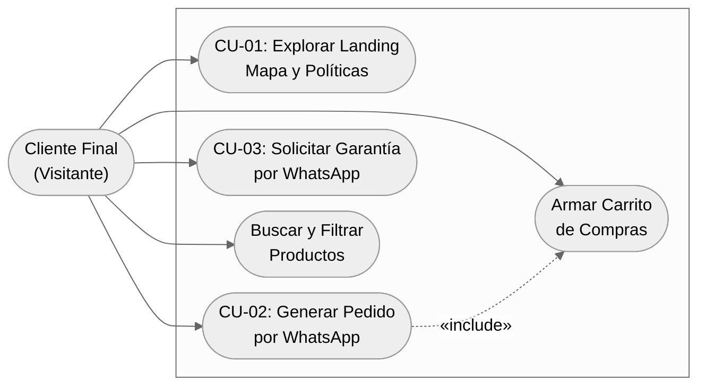
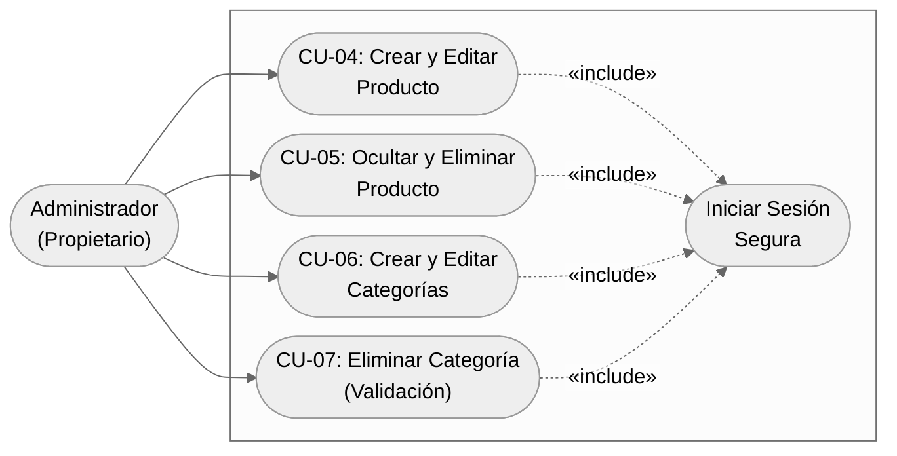

# Especificación de Requisitos de Software (SRS)
**Proyecto:** Plataforma Web y Catálogo E-Commerce - Laboratorio Diésel  
**Versión:** 1.0 (MVP)  
**Metodología:** Kanban (Estimación: 1 mes de desarrollo continuo)  
**Garantía Técnica:** 30 días post-despliegue (exclusivo para corrección de bugs)

---

## 1. INTRODUCCIÓN

### 1.1 Alcance
El sistema consiste en una plataforma web integral (MVP) compuesta por una **Landing Page institucional**, un **Catálogo E-Commerce avanzado** y un **Panel de Administración (Backoffice)** autogestionable para la firma **Laboratorio Diésel**, ubicada en Villa Mercedes, San Luis.

**Qué HARÁ el sistema en esta fase (En Alcance):**
* Presentar la propuesta de valor del taller, servicios, políticas de garantía y ubicación física mediante un mapa interactivo (iframe de Google Maps) respetando la identidad visual en tonos azules.
* Permitir a los clientes explorar un catálogo digital de inyectores y repuestos diésel con filtrado por marcas, categorías y subcategorías, además de un motor de búsqueda global por **Código OEM**, **marca** o **modelo de vehículo**.
* Gestionar precios de forma flexible (visibles en ARS o bajo modalidad *"Consultar precio / A cotizar"* para pedidos a demanda).
* Permitir el armado de un carrito de compras cuyo cierre (checkout) redirige directamente a **WhatsApp** con un mensaje estructurado listo para enviar al vendedor.
* Proveer un botón de acceso directo a WhatsApp para consultas y gestión de **Garantías**, acompañado de su sección informativa de políticas y términos.
* Proveer un **Panel de Administración seguro** para el alta, baja y modificación (ABM) de productos, marcas, categorías y subcategorías anidadas.
* Configuración de servidor de producción y gestión de dominio `.com.ar` (costos de infraestructura a cargo del cliente).

**Qué NO HARÁ el sistema en esta fase (Fuera de Alcance - Exclusiones del MVP):**
* **Sin pasarela de pagos electrónica:** No se integrará Mercado Pago, tarjetas de crédito/débito ni transferencias automáticas dentro de la web. El pago se coordina manualmente por WhatsApp.
* **Sin gestión ni descuento de stock:** El sistema no lleva conteo de inventario ni descuenta unidades al generar pedidos.
* **Sin facturación ni logística automatizada:** Queda excluida la integración con ARCA/AFIP, sistemas ERP externos y calculadoras automáticas de correo (Andreani, Correo Argentino, etc.).
* **Sin carga inicial de datos (Data Entry):** El sistema se entrega con la base de datos limpia y operativa, incluyendo una sesión de capacitación para que el cliente realice la carga y administración del catálogo al 100%.
* **Sin diseño de marca desde cero (Branding):** Se utilizará la denominación tipográfica "Laboratorio Diésel" y una paleta de tonos azules profesionales sin desarrollo de manual de identidad corporativa.

### 1.2 Objetivos
1. **Digitalizar el catálogo comercial:** Centralizar el 100% de la oferta de inyectores y repuestos diésel en una plataforma web accesible las 24 horas.
2. **Acelerar la identificación de repuestos:** Reducir el tiempo de consulta técnica permitiendo que el comprador filtre o busque piezas por código OEM o compatibilidad vehicular en menos de 2 segundos.
3. **Estandarizar la recepción de pedidos y garantías:** Estructurar el 100% de las consultas de compra y solicitudes de garantía que llegan al WhatsApp del taller mediante mensajes pre-formateados con el detalle exacto de las piezas requeridas.
4. **Garantizar autonomía operativa:** Dotar al dueño del taller de un panel autogestionable para actualizar precios, ocultar productos o crear categorías jerárquicas en menos de 1 minuto sin depender del equipo de desarrollo.

---

## 2. INFORMACIÓN DEL DOMINIO DEL PROBLEMA

### 2.1 Introducción al Dominio del Problema
La comercialización de inyectores y repuestos de inyección diésel requiere alta precisión técnica. Un mismo vehículo puede utilizar distintas variantes de piezas según su motorización o año, por lo que los mecánicos y clientes finales suelen buscar repuestos utilizando el **Código OEM** (código grabado en la pieza original) o combinando marca y modelo del vehículo.

Asimismo, el taller opera con repuestos disponibles en mostrador y repuestos **a demanda** (pedidos especiales a proveedores cuando el cliente confirma la compra) o modalidades de **recambio**. Debido a la fluctuación de costos en repuestos importados y pedidos bajo demanda, el negocio necesita publicar ciertos productos con precio fijo y otros bajo la modalidad *"Consultar precio"*, cerrando la cotización final, disponibilidad y logística de envío de manera personalizada a través de WhatsApp.

### 2.2 Glosario de Términos
* **Código OEM (Original Equipment Manufacturer):** Número de serie o código alfanumérico único asignado por el fabricante original de la pieza (ej. Bosch, Delphi, Denso) que garantiza la compatibilidad exacta del repuesto.
* **Pieza de Recambio / Reacondicionada:** Modalidad comercial donde el cliente entrega su inyector o repuesto usado como parte de la operación para recibir una unidad reparada a nuevo y calibrada en banco de pruebas.
* **Venta a Demanda:** Productos publicados en el catálogo que el taller encarga a sus distribuidores únicamente cuando el cliente confirma el pedido, razón por la cual su precio puede requerir cotización al momento de la consulta.
* **Categoría Jerárquica (Subcategoría):** Estructura de árbol donde una categoría padre (ej. *Inyección Electrónica*) puede contener múltiples subcategorías hijas (ej. *Inyectores Common Rail*, *Bombas de Alta Presión*, *Válvulas Solenoides*).
* **Checkout por WhatsApp:** Proceso de cierre de carrito que compila los productos seleccionados en un texto estructurado y abre la API de WhatsApp (`wa.me`) hacia el número oficial del taller.
* **Backoffice / Panel de Administración:** Interfaz privada protegida por credenciales donde el propietario gestiona el catálogo de productos y taxonomías.

---

## 3. NECESIDADES DE NEGOCIO

### 3.1 Objetivos de Negocio de Clientes y Usuarios
* **Objetivos del Propietario (Laboratorio Diésel):**
  * Posicionar la presencia digital del taller en Villa Mercedes y expandir el alcance comercial a nivel regional y nacional.
  * Evitar pérdidas de tiempo en WhatsApp respondiendo consultas ambiguas, recibiendo desde la web el detalle exacto de lo que el cliente necesita comprar o reclamar por garantía.
  * Mantener el control total sobre qué precios se muestran públicamente y cuáles requieren cotización al día.
* **Objetivos del Cliente Final (Mecánicos, Transportistas, Particulares):**
  * Verificar rápidamente si Laboratorio Diésel comercializa el repuesto específico para su motor mediante búsqueda por código OEM o filtros de marca/categoría.
  * Conocer la ubicación física del taller, el trabajo que realizan y las condiciones de garantía antes de iniciar el contacto comercial.
  * Armar un pedido con múltiples repuestos y enviarlo en un solo clic a WhatsApp sin necesidad de crear una cuenta de usuario ni ingresar datos bancarios en la web.

### 3.2 Modelos de Procesos de Negocio a Implantar

#### 3.2.1 Descripción de los Actores de Negocio a Implantar

| Actor | Descripción y Rol en el Sistema |
| :--- | :--- |
| **Cliente Final (Visitante)** | Usuario público no autenticado que navega la Landing Page, consulta políticas de garantía, busca/filtra repuestos en el catálogo, gestiona su carrito de compras e inicia el contacto comercial o de garantía vía WhatsApp. |
| **Administrador** | Propietario o personal designado de Laboratorio Diésel. Posee acceso autenticado al Backoffice para gestionar categorías, subcategorías, marcas, productos, precios y visibilidad del catálogo. |

#### 3.2.2 Descripción de Procesos de Negocio a Implantar
1. **Exploración y Búsqueda Técnica de Repuestos:** El cliente accede al catálogo y localiza piezas combinando el buscador global (OEM, marca, modelo) con los filtros de categorías/subcategorías y marcas.
2. **Armado de Pedido y Cierre vía WhatsApp:** El cliente selecciona uno o más productos (tengan precio fijo o sean a cotizar), revisa el resumen en su carrito y genera el mensaje automático hacia el WhatsApp del taller.
3. **Gestión de Consultas de Garantía:** El cliente revisa los términos de garantía en la web y utiliza el botón dedicado para enviar un mensaje pre-configurado de soporte/garantía al WhatsApp del taller.
4. **Administración del Catálogo y Taxonomías (ABM):** El administrador inicia sesión, estructura el árbol de categorías/subcategorías y publica o actualiza productos definiendo sus campos obligatorios y opcionales.

---

## 4. CASOS DE USO DEL SISTEMA (MVP)

### 4.1 Casos de Uso

#### CU-01: Buscar y Filtrar Productos en el Catálogo
| Campo | Descripción |
| :--- | :--- |
| **Nombre** | Buscar y Filtrar Productos en el Catálogo |
| **Actor** | Cliente Final |
| **Precondición** | El sistema cuenta con productos activos ("Visibles") cargados en la base de datos. |
| **Flujo Principal** | 1. El Cliente Final ingresa a la sección de Catálogo. 2. El usuario ingresa un término en el buscador global (Código OEM, marca o modelo de vehículo) y/o selecciona filtros laterales de Categoría, Subcategoría o Marca. 3. El sistema procesa los criterios de forma combinada y actualiza la grilla de productos mostrando únicamente las coincidencias. 4. El usuario hace clic en un producto para ver su ficha detallada (Nombre, Foto, Descripción, Categorías, Precio o leyenda "Consultar precio"). |
| **Flujo Alternativo** | **3a. Sin coincidencias:** Si ningún producto coincide, el sistema muestra un mensaje claro indicando que no se encontraron resultados y ofrece un botón para consultar directamente por WhatsApp. |

#### CU-02: Generar Pedido por WhatsApp (Checkout)
| Campo | Descripción |
| :--- | :--- |
| **Nombre** | Generar Pedido por WhatsApp |
| **Actor** | Cliente Final |
| **Precondición** | El Cliente Final ha agregado al menos un producto al carrito de compras. |
| **Flujo Principal** | 1. El Cliente Final abre el carrito de compras y visualiza los ítems seleccionados, cantidades y precios unitarios (o etiqueta "Precio a cotizar"). 2. El Cliente Final presiona el botón "Comprar / Consultar por WhatsApp". 3. El sistema construye dinámicamente una URL hacia la API de WhatsApp con un mensaje pre-formateado con el detalle del pedido. 4. El sistema redirige al usuario a la aplicación de WhatsApp. |
| **Flujo Alternativo** | **1a. Carrito vacío:** Si el carrito no posee productos, el botón de finalizar compra permanece deshabilitado. |

> **📌 NOTA DE CONSULTORÍA (Punto a validar con el cliente en reunión de cierre de SRS):**  
> Validar si desea mantener el salto directo a WhatsApp o si prefiere desplegar un breve modal previo donde el comprador ingrese opcionalmente Nombre y Localidad para incluir esos datos en el mensaje.

#### CU-03: Solicitar Garantía vía WhatsApp
| Campo | Descripción |
| :--- | :--- |
| **Nombre** | Solicitar Garantía vía WhatsApp |
| **Actor** | Cliente Final |
| **Precondición** | Ninguna. |
| **Flujo Principal** | 1. El Cliente Final navega hacia la sección de Garantías y Políticas en la web. 2. El usuario presiona el botón directo de "Solicitar Garantía / Soporte". 3. El sistema redirige a WhatsApp con un mensaje prearmado para agilizar el reclamo. |
| **Flujo Alternativo** | N/A |

#### CU-04: Crear y Editar Producto
| Campo | Descripción |
| :--- | :--- |
| **Nombre** | Crear y Editar Producto |
| **Actor** | Administrador |
| **Precondición** | El Administrador ha iniciado sesión y existe al menos una Categoría creada. |
| **Flujo Principal** | 1. El Administrador accede al módulo de Productos y selecciona "Nuevo Producto" o "Editar". 2. Completa los campos obligatorios: Nombre, Descripción, Foto y selecciona al menos una Categoría. 3. Completa opcionales: Código OEM, Marca, Compatibilidad, Precio y Visibilidad. 4. Guarda los cambios y el sistema publica el producto. |
| **Flujo Alternativo** | **4a. Faltan datos:** El sistema impide el guardado y resalta los campos obligatorios faltantes. |

#### CU-05: Ocultar y Eliminar Producto
| Campo | Descripción |
| :--- | :--- |
| **Nombre** | Ocultar y Eliminar Producto |
| **Actor** | Administrador |
| **Precondición** | El Administrador se encuentra autenticado en el módulo de Productos. |
| **Flujo Principal** | 1. El Administrador selecciona un producto del listado. 2. Para **ocultar**: Cambia el interruptor de "Visible" a "Pausado/Oculto". El sistema actualiza el estado y el producto deja de mostrarse al Cliente Final sin borrarse de la base de datos. 3. Para **eliminar**: Selecciona la opción eliminar. El sistema pide confirmación y borra permanentemente el registro. |
| **Flujo Alternativo** | N/A |

#### CU-06: Crear y Editar Categorías / Subcategorías
| Campo | Descripción |
| :--- | :--- |
| **Nombre** | Crear y Editar Categorías |
| **Actor** | Administrador |
| **Precondición** | El Administrador ha iniciado sesión en el Backoffice. |
| **Flujo Principal** | 1. El Administrador accede al módulo de Categorías y selecciona "Nueva Categoría" o "Editar". 2. Ingresa el nombre de la categoría. 3. Opcionalmente, selecciona una "Categoría Padre" si desea que funcione como subcategoría jerárquica. 4. El sistema guarda la estructura y actualiza los filtros del catálogo. |
| **Flujo Alternativo** | **2a. Nombre duplicado:** El sistema advierte si ya existe una categoría con ese nombre exacto. |

#### CU-07: Eliminar Categoría o Subcategoría
| Campo | Descripción |
| :--- | :--- |
| **Nombre** | Eliminar Categoría o Subcategoría (Validación de Integridad) |
| **Actor** | Administrador |
| **Precondición** | El Administrador se encuentra autenticado en el módulo de Categorías. |
| **Flujo Principal** | 1. El Administrador selecciona la opción "Eliminar" sobre una categoría. 2. El sistema verifica que la categoría no tenga productos asociados. 3. El sistema solicita confirmación y elimina el registro de la base de datos. |
| **Flujo Alternativo** | **2a. Bloqueo por Integridad:** Si la categoría tiene productos vinculados, el sistema impide la eliminación y despliega una alerta listando los productos afectados para que sean reasignados primero. |

### 4.2 Diagramas de Casos de Uso

#### 4.2.1 Subsistema Público y Catálogo (Actor: Cliente Final)

#### 4.2.2 Subsistema Backoffice (Actor: Administrador)

## 5. REQUISITOS FUNCIONALES DEL SISTEMA

### 5.1 Landing Page, Políticas y Garantía
* **5.1.1:** El sistema deberá mostrar una Landing Page institucional diseñada con una paleta de colores en tonos azules, presentando los servicios y el trabajo técnico de Laboratorio Diésel.
* **5.1.2:** El sistema deberá incluir en la Landing Page un mapa interactivo embebido (iframe de Google Maps) con la ubicación exacta del local en Villa Mercedes, San Luis.
* **5.1.3:** El sistema deberá contar con una sección dedicada a las Políticas Comerciales, Términos y Condiciones de Garantía.
* **5.1.4:** El sistema deberá proveer un botón directo de "Garantía" que redirija al usuario hacia el WhatsApp del taller con un mensaje predefinido para iniciar gestiones de posventa o reclamos.

### 5.2 Catálogo, Categorización y Motor de Búsqueda
* **5.2.1:** El sistema deberá mostrar en el catálogo público únicamente aquellos productos cuyo estado esté configurado como "Activo / Visible".
* **5.2.2:** El sistema deberá permitir buscar productos mediante una barra de búsqueda global ingresando el **Código OEM**, el **nombre del producto**, la **marca** o el **modelo del vehículo compatible**.
* **5.2.3:** El sistema deberá permitir filtrar el catálogo de productos por **Marca** y por **Categorías / Subcategorías**.
* **5.2.4:** El sistema deberá mostrar un mensaje informativo claro cuando una búsqueda o combinación de filtros no arroje resultados, ofreciendo un enlace directo a WhatsApp para consultar por la pieza buscada.
* **5.2.5:** El sistema deberá mostrar en la tarjeta y ficha de cada producto su precio en Pesos Argentinos (ARS) únicamente cuando el administrador haya cargado un valor y habilitado su visualización; en caso contrario, el sistema deberá mostrar la leyenda **"Consultar precio"**.

### 5.3 Carrito de Compras y Cierre por WhatsApp (Checkout)
* **5.3.1:** El sistema deberá permitir al Cliente Final agregar uno o múltiples productos al carrito de compras y modificar las cantidades deseadas de cada ítem, sin aplicar restricciones ni descuentos de stock.
* **5.3.2:** El sistema deberá permitir agregar al carrito tanto productos con precio definido como productos bajo modalidad *"Consultar precio"*.
* **5.3.3:** El sistema deberá persistir el estado del carrito de compras en el navegador del usuario (`localStorage`) para evitar la pérdida de la selección al recargar la página.
* **5.3.4:** El sistema deberá generar, al presionar el botón de compra en el carrito, un enlace hacia la API de WhatsApp (`[https://wa.me/](https://wa.me/)`) dirigido al número oficial de Laboratorio Diésel con un mensaje estructurado que detalle: lista de productos, códigos OEM (si existen), cantidades y precios unitarios (o etiqueta *"A cotizar"*).

### 5.4 Panel de Administración (Seguridad y Gestión de Catálogo)
* **5.4.1:** El sistema deberá permitir al Administrador iniciar sesión mediante correo electrónico/usuario y contraseña.
* **5.4.2:** El sistema deberá impedir el acceso a cualquier ruta o acción del Panel de Administración a usuarios no autenticados, redirigiéndolos al formulario de inicio de sesión.
* **5.4.3:** El sistema deberá permitir al Administrador crear, editar y listar **Categorías** y **Subcategorías** (permitiendo anidar categorías dentro de otras categorías).
* **5.4.4:** El sistema deberá **impedir** la eliminación de una categoría o subcategoría si existen productos asociados a ella, debiendo mostrar en pantalla el listado de los productos vinculados para que el Administrador los reasigne o elimine previamente.
* **5.4.5:** El sistema deberá permitir al Administrador crear, editar y eliminar **Marcas** para su asignación y filtrado en el catálogo.
* **5.4.6:** El sistema deberá exigir como campos obligatorios para el alta o edición de un producto: **Nombre**, **Descripción**, **una (1) Foto** y **al menos una (1) Categoría/Subcategoría**.
* **5.4.7:** El sistema deberá permitir asociar un mismo producto a **una o múltiples categorías/subcategorías** simultáneamente.
* **5.4.8:** El sistema deberá permitir cargar como campos opcionales del producto: **Código OEM**, **Marca**, **Marca/Modelo de vehículo compatible**, **Condición de la pieza**, **Precio** y un selector booleano para **Mostrar/Ocultar el precio** en el catálogo público.
* **5.4.9:** El sistema deberá permitir al Administrador pausar/ocultar temporalmente un producto del catálogo público o eliminarlo definitivamente de la base de datos.

---

## 6. REQUISITOS NO FUNCIONALES DEL SISTEMA

| ID         | Categoría                            | Requisito No Funcional                                                                                                                                                                                                                                               |
| :--------- | :----------------------------------- | :------------------------------------------------------------------------------------------------------------------------------------------------------------------------------------------------------------------------------------------------------------------- |
| **RNF-01** | **Rendimiento**                      | El motor de búsqueda global y el filtrado por categorías/marcas deberán devolver y renderizar los resultados en el navegador en un tiempo inferior a **2 segundos** bajo condiciones normales de conexión.                                                           |
| **RNF-02** | **Usabilidad y Diseño (Responsive)** | La interfaz pública (Landing, Catálogo y Carrito) y el Panel de Administración deberán contar con un diseño *Mobile-First* y *Responsive*, adaptándose correctamente a smartphones, tablets y monitores de escritorio.                                               |
| **RNF-03** | **Identidad Visual**                 | La interfaz de usuario deberá emplear una línea estética profesional basada en una **paleta de colores azules**, neutros y blancos que refleje limpieza técnica y confiabilidad para "Laboratorio Diésel".                                                           |
| **RNF-04** | **Seguridad**                        | Las contraseñas de acceso al Panel de Administración deberán almacenarse hasheadas en la base de datos (ej. mediante `bcrypt`). Las rutas y endpoints de modificación de datos deberán estar protegidos mediante sesiones seguras o tokens (JWT).                    |
| **RNF-05** | **Optimización Multimedia**          | El sistema deberá restringir la subida de archivos en el formulario de productos exclusivamente a formatos de imagen web (`.jpg`, `.png`, `.webp`) con un límite de peso razonable (ej. máx. 5 MB por foto) para preservar la velocidad de carga del catálogo.       |
| **RNF-06** | **Despliegue y Disponibilidad**      | El sistema será desplegado en un entorno de servidor productivo bajo un dominio `.com.ar` registrado a nombre del cliente, utilizando protocolo seguro **HTTPS (Certificado SSL)** activo las 24 horas.                                                              |
| **RNF-07** | **Mantenibilidad y Garantía**        | El código fuente será estructurado de forma modular y contará con una garantía técnica de **30 días corridos post-despliegue** destinada exclusivamente a la resolución de errores de programación (bugs) sobre las funcionalidades especificadas en este documento. |