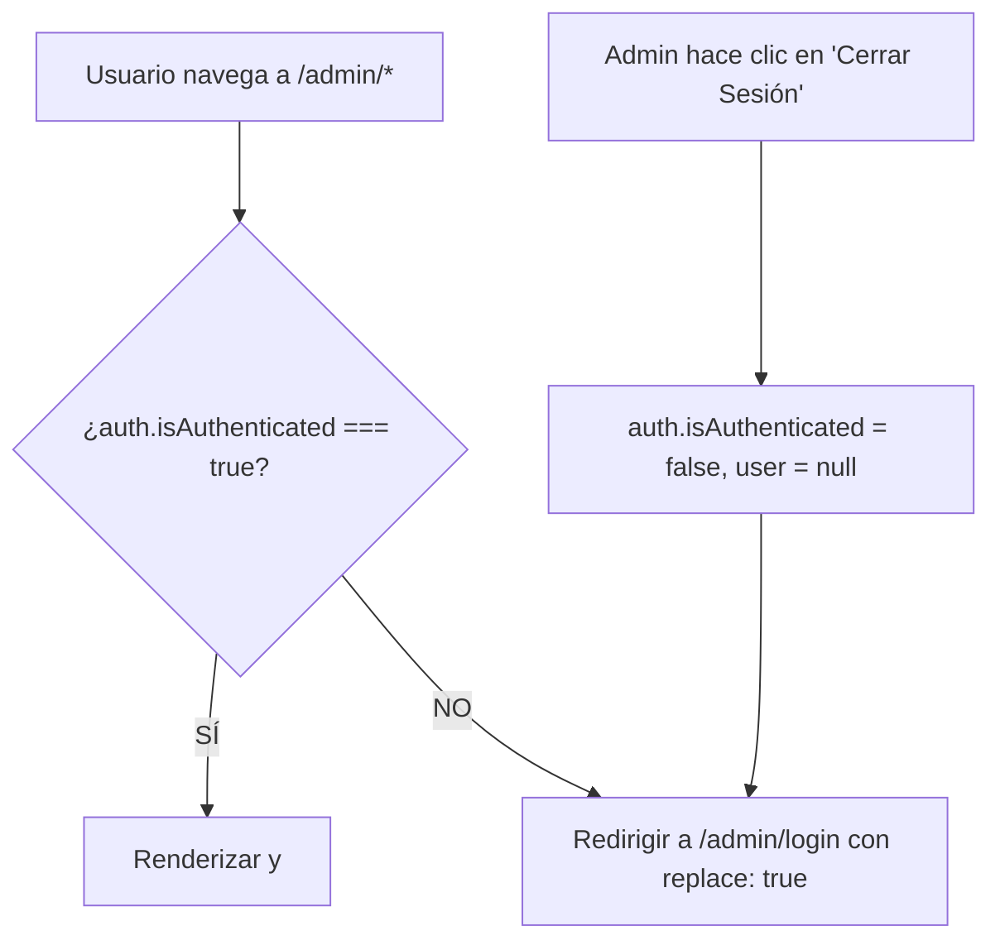

# Plan Técnico de Implementación: Panel de Administración y Seguridad (Backoffice)

**Fase:** 004-admin-panel  
**Versión:** 1.2 (Alineado con spec v1.2, `docs/constitution.md` y `AGENTS.MD`)  
**Fecha:** 2026-10-18  
**Especificación:** [specs/004-admin-panel/spec.md](file:///f:/INGENIERIA/GEPI/InyectoresDiesel/specs/004-admin-panel/spec.md)  
**Marco Normativo:** [docs/constitution.md](file:///f:/INGENIERIA/GEPI/InyectoresDiesel/docs/constitution.md) y [AGENTS.MD](file:///f:/INGENIERIA/GEPI/InyectoresDiesel/AGENTS.MD)  
**Estado:** Documento de Planificación de Arquitectura Técnica

---

## 1. Estructura de Componentes y Enrutamiento

### 1.1 Árbol de Rutas bajo `/admin` (TanStack Router) `(RF-01, RF-02, RF-04, RF-05, RF-10, RF-12)`

El enrutamiento de administración se organiza de forma modular y desacoplada de las rutas públicas (`/` y `/catalogo`), aprovechando el sistema de rutas basado en archivos de TanStack Router:

```
src/routes/
├── admin.tsx                     <-- Layout protegido de administración (Sidebar, Header, Logout y AdminGuard) (RF-02, RNF-P4-01)
├── admin.login.tsx               <-- Vista pública de acceso al backoffice (/admin/login) (RF-01)
├── admin.index.tsx               <-- Vista raíz (/admin) -> Módulo de Gestión de Productos (RF-05, RF-06, RF-07)
├── admin.dashboard.tsx           <-- Vista de métricas e indicadores (/admin/dashboard) (RF-04)
├── admin.categorias.tsx          <-- Vista de gestión de taxonomías (/admin/categorias) (RF-10, RF-11)
└── admin.marcas.tsx              <-- Vista de gestión de marcas (/admin/marcas) (RF-12)
```

### 1.2 Jerarquía de Componentes de UI `(RNF-P4-03)`

```
<AdminAuthProvider> (src/context/admin-auth-context.tsx) (RF-01, RF-02, RNF-P4-01)
│
├── [Ruta: /admin/login] (admin.login.tsx)
│   └── <AdminLoginForm> (src/components/admin/auth/AdminLoginForm.tsx) (RF-01)
│       ├── Input[email] (autocompletado habilitado) (CA-01.4)
│       ├── Input[password] (autocompletado habilitado) (CA-01.4)
│       └── SubmitButton (con feedback de carga y estado isSubmitting en finally) (CA-01.1, CA-01.5)
│
└── [Layout: /admin] (admin.tsx)
    └── <AdminGuard> (src/components/admin/auth/AdminGuard.tsx) (RF-02)
        └── <AdminProvider> (src/context/admin-context.tsx) (RF-15)
            ├── <AdminSidebar> (src/components/admin/layout/AdminSidebar.tsx) (RNF-P4-03)
            │   ├── BrandTypography ("Laboratorio Diésel - Backoffice")
            │   ├── NavItem["Productos"] (/admin)
            │   ├── NavItem["Dashboard"] (/admin/dashboard)
            │   ├── NavItem["Categorías"] (/admin/categorias)
            │   ├── NavItem["Marcas"] (/admin/marcas)
            │   └── NavItem["Ver tienda"] (/catalogo - externa)
            │
            ├── <AdminHeader> (src/components/admin/layout/AdminHeader.tsx)
            │   ├── SidebarToggleButton (colapso/expansión)
            │   ├── UserBadge ("admin@laboratoriodiesel.com")
            │   └── LogoutButton (dispara logout() y redirige a /admin/login) (RF-02, CA-02.3)
            │
            └── <main> (<Outlet /> de TanStack Router)
                │
                ├── [Vista: /admin - Productos] (admin.index.tsx) (RF-05, RF-06, RF-07)
                │   ├── <ProductToolbar> (Buscador literal/sanitizado + Filtros rápidos + Botón "Nuevo Producto") (CA-06.4)
                │   ├── <ProductTable> (src/components/admin/products/ProductTable.tsx)
                │   │   ├── TableRow[]
                │   │   │   ├── <ProductThumbnail> (Render con fallback gráfico onError) (RF-06, CA-06.3)
                │   │   │   ├── Text[Nombre, OEM, Marca normalizada por brandId, Precio ARS o 'Consultar']
                │   │   │   ├── <VisibilitySwitch> (Toggle inmediato Visible/Oculto) (RF-06, CA-06.1)
                │   │   │   └── ActionButtons[Editar, Eliminar]
                │   ├── <ProductFormModal> (src/components/admin/products/ProductFormModal.tsx) (RF-05)
                │   │   ├── Input[Nombre] (Zod onBlur/onSubmit)
                │   │   ├── Textarea[Descripción]
                │   │   ├── <ProductImageUpload> (Validación <= 5MB, tipos webp/jpg/png, preview y sobrescritura) (RF-08)
                │   │   ├── SelectMultiple[Categorías] (Array plano categoryIds) (CA-05.3)
                │   │   ├── Select[Marca] (Almacena brandId) (CA-05.2)
                │   │   ├── Input[Vehículo compatible] (Texto libre) (CA-05.2)
                │   │   ├── Select[Condición] (Enum: 'Nuevo' | 'Reacondicionado' | 'Usado') (CA-05.2)
                │   │   ├── Input[Precio ARS] (Zod nonnegative, admite $0) (CA-05.2)
                │   │   ├── Toggle[Mostrar Precio] y Toggle[Visible]
                │   │   └── SubmitButton (isSubmitting en bloque finally) (CA-05.4, CL-12)
                │   └── <ProductDeleteModal> (Modal confirmación con botón rojo destructivo) (RF-07)
                │
                ├── [Vista: /admin/dashboard - Métricas] (admin.dashboard.tsx) (RF-04)
                │   ├── <MetricCardsGrid> (5 tarjetas reactivas: Total, Visibles, Ocultos, Categorías, Marcas) (CA-04.1)
                │   └── <QuickNavigationLinks> (Accesos directos a los 3 submódulos ABM) (CA-04.2)
                │
                ├── [Vista: /admin/categorias - Categorías] (admin.categorias.tsx) (RF-10, RF-11)
                │   ├── <CategoryList> (Árbol con indentación visual para subcategorías hijas) (CA-10.1, CA-10.2)
                │   ├── <CategoryFormModal> (Input Nombre + Selector Padre limitado a categorías raíz, inhabilitado si la categoría editada ya tiene hijas) (RF-10, CL-05)
                │   └── <CategoryDeleteModal> (Modal con bloqueo estricto impeditivo si tiene productos o subcategorías) (RF-11)
                │
                └── [Vista: /admin/marcas - Marcas] (admin.marcas.tsx) (RF-12)
                    ├── <BrandList> (Tabla de marcas con conteo de productos vinculados) (CA-12.1)
                    ├── <BrandFormModal> (Input Nombre con validación Zod de unicidad case-insensitive) (CA-12.2)
                    └── <BrandDeleteModal> (Modal con bloqueo estricto impeditivo si brandId está en uso) (CA-12.3)
```

---

## 2. Modelo de Estado en Memoria (JSON)

### 2.1 Estructura del Estado Global (`AdminContext`) `(RF-15, D-01, D-05, D-14, RNF-P4-01)`

El estado global de administración simula la base de datos relacional PostgreSQL en memoria volátil de JavaScript (React Context), garantizando que no se persiste ningún dato en `localStorage` o `sessionStorage` (respetando estrictamente `docs/constitution.md` §4 y §5).

Todos los identificadores se generan y mantienen en formato **UUIDv4** estándar mediante `crypto.randomUUID()`.

```typescript
// Tipado central del estado en memoria
export interface AdminState {
  // Estado de Autenticación (en memoria por pestaña) (RF-01, RF-02, RNF-P4-01)
  auth: {
    isAuthenticated: boolean;
    user: {
      id: string; // UUIDv4
      email: string;
      role: "admin";
    } | null;
  };

  // Taxonomías (RF-10, RF-11)
  categories: AdminCategory[];

  // Fabricantes (RF-12)
  brands: AdminBrand[];

  // Catálogo de Productos (RF-05, RF-06, RF-07)
  products: AdminProduct[];
}
```

### 2.2 Datos Semilla Iniciales (`src/lib/admin-seed-data.ts`) `(RF-15, CA-15.1)`

Representación literal en formato JSON de las entidades semilla inicializadas al arrancar o refrescar la aplicación:

```json
{
  "auth": {
    "isAuthenticated": false,
    "user": null
  },
  "categories": [
    {
      "id": "e4b6d812-7a2b-4f51-b8f3-0a567c891001",
      "name": "Inyección Common Rail",
      "parentId": null
    },
    {
      "id": "e4b6d812-7a2b-4f51-b8f3-0a567c891002",
      "name": "Inyectores Common Rail",
      "parentId": "e4b6d812-7a2b-4f51-b8f3-0a567c891001"
    },
    {
      "id": "e4b6d812-7a2b-4f51-b8f3-0a567c891003",
      "name": "Bombas de Alta Presión",
      "parentId": "e4b6d812-7a2b-4f51-b8f3-0a567c891001"
    },
    {
      "id": "e4b6d812-7a2b-4f51-b8f3-0a567c891004",
      "name": "Inyección Piezoeléctrica",
      "parentId": null
    },
    {
      "id": "e4b6d812-7a2b-4f51-b8f3-0a567c891005",
      "name": "Inyectores Piezoeléctricos",
      "parentId": "e4b6d812-7a2b-4f51-b8f3-0a567c891004"
    },
    {
      "id": "e4b6d812-7a2b-4f51-b8f3-0a567c891006",
      "name": "Bombas e Inyección Mecánica",
      "parentId": null
    }
  ],
  "brands": [
    {
      "id": "b1a2c3d4-0001-4000-8000-000000000001",
      "name": "Bosch"
    },
    {
      "id": "b1a2c3d4-0002-4000-8000-000000000002",
      "name": "Delphi"
    },
    {
      "id": "b1a2c3d4-0003-4000-8000-000000000003",
      "name": "Denso"
    }
  ],
  "products": [
    {
      "id": "a0f1e2d3-1111-4000-8000-111111111111",
      "name": "Inyector Amarok 2.0 TDI",
      "description": "Inyector de alta precisión para motorización 2.0 TDI. Calibrado en banco de pruebas.",
      "imageUrl": "/uploads/amarok-20-tdi.webp",
      "categoryIds": [
        "e4b6d812-7a2b-4f51-b8f3-0a567c891001",
        "e4b6d812-7a2b-4f51-b8f3-0a567c891002"
      ],
      "brandId": "b1a2c3d4-0001-4000-8000-000000000001",
      "vehicleCompatibility": "Volkswagen Amarok 2.0 TDI (2010-2021)",
      "condition": "Nuevo",
      "price": 320000,
      "showPrice": true,
      "visible": true,
      "oem": "0445110369"
    },
    {
      "id": "a0f1e2d3-2222-4000-8000-222222222222",
      "name": "Inyector Ranger 3.2 TDCi",
      "description": "Unidad de inyección common rail Delphi reparada a nuevo con tobera y válvula original.",
      "imageUrl": "/uploads/ranger-32-tdci.webp",
      "categoryIds": [
        "e4b6d812-7a2b-4f51-b8f3-0a567c891002"
      ],
      "brandId": "b1a2c3d4-0002-4000-8000-000000000002",
      "vehicleCompatibility": "Ford Ranger 3.2 TDCi Puma (2012-2022)",
      "condition": "Reacondicionado",
      "price": null,
      "showPrice": false,
      "visible": true,
      "oem": "28236381"
    },
    {
      "id": "a0f1e2d3-3333-4000-8000-333333333333",
      "name": "Inyector Hilux 3.0 D-4D",
      "description": "Inyector Denso original para línea Toyota Hilux 1KD-FTV. Envasado de fábrica.",
      "imageUrl": "/uploads/hilux-30-d4d.webp",
      "categoryIds": [
        "e4b6d812-7a2b-4f51-b8f3-0a567c891002"
      ],
      "brandId": "b1a2c3d4-0003-4000-8000-000000000003",
      "vehicleCompatibility": "Toyota Hilux / SW4 3.0 D-4D (2005-2015)",
      "condition": "Nuevo",
      "price": 320000,
      "showPrice": true,
      "visible": false,
      "oem": "23670-0L050"
    },
    {
      "id": "a0f1e2d3-4444-4000-8000-444444444444",
      "name": "Inyector Sprinter 2.2 CDI",
      "description": "Inyector piezoeléctrico Bosch probado en banco EPS 205. Parámetros de preinyección certificados.",
      "imageUrl": "/uploads/sprinter-22-cdi.webp",
      "categoryIds": [
        "e4b6d812-7a2b-4f51-b8f3-0a567c891004",
        "e4b6d812-7a2b-4f51-b8f3-0a567c891005"
      ],
      "brandId": "b1a2c3d4-0001-4000-8000-000000000001",
      "vehicleCompatibility": "Mercedes-Benz Sprinter 311 / 415 / 515 CDI (OM651)",
      "condition": "Usado",
      "price": 0,
      "showPrice": true,
      "visible": true,
      "oem": "0445115007"
    }
  ]
}
```

---

## 3. Esquemas de Validación Centrales (Fail-Fast con Zod)

Alineado con `AGENTS.MD` §3 y `docs/constitution.md` §2, toda entrada de usuario se valida agresivamente con esquemas Zod en modo estricto (`.strict()`) antes de ejecutar cualquier mutación de negocio.

### 3.1 Esquema de Variables de Entorno (Crash Early) `(RF-14, CA-14.1, CA-14.2, CA-14.3)`

```typescript
import { z } from "zod";

export const envSchema = z.object({
  VITE_API_URL: z.string().min(1, "VITE_API_URL no puede ser vacía"),
  VITE_CONTACT_WHATSAPP: z.string().min(8, "VITE_CONTACT_WHATSAPP inválido"),
  MODE: z.string().optional(),
  PROD: z.boolean().optional(),
}).strict();

export function validateEnv() {
  const rawEnv = {
    VITE_API_URL: import.meta.env.VITE_API_URL,
    VITE_CONTACT_WHATSAPP: import.meta.env.VITE_CONTACT_WHATSAPP,
    MODE: import.meta.env.MODE,
    PROD: import.meta.env.PROD,
  };

  // Fallback seguro en Desarrollo/Testing (CA-14.2)
  if (!import.meta.env.PROD && (!rawEnv.VITE_API_URL || !rawEnv.VITE_CONTACT_WHATSAPP)) {
    console.warn("[AppSec ENV] Operando con variables de entorno por defecto para desarrollo local.");
    return {
      VITE_API_URL: rawEnv.VITE_API_URL || "http://localhost:3000/api",
      VITE_CONTACT_WHATSAPP: rawEnv.VITE_CONTACT_WHATSAPP || "5492657659108",
    };
  }

  // Crash Early estricto en Producción (CA-14.3)
  const result = envSchema.safeParse(rawEnv);
  if (!result.success) {
    const errorDetails = result.error.errors.map(e => `${e.path.join(".")}: ${e.message}`).join("\n");
    console.error("FATAL: Variables de entorno inválidas o ausentes:\n", errorDetails);
    throw new Error(`[Crash Early] Faltan variables de entorno requeridas:\n${errorDetails}`);
  }
  return result.data;
}
```

### 3.2 Esquema de Autenticación `(RF-01, CA-01.3, RNF-P4-02)`

```typescript
export const loginSchema = z.object({
  email: z
    .string({ required_error: "El correo electrónico es obligatorio" })
    .trim()
    .min(1, "El correo electrónico es obligatorio")
    .email("Formato de correo electrónico inválido"),
  password: z
    .string({ required_error: "La contraseña es obligatoria" })
    .min(1, "La contraseña es obligatoria"),
}).strict(); // .strict() captura cualquier campo inyectado inesperado
```

### 3.3 Esquema de Archivo de Imagen (Desacoplado de `File`) `(RF-08, CA-08.1, CA-08.2, CA-08.3, CL-01, CL-02)`

Para respetar el control `.strict()` sin fallar por las propiedades nativas del prototipo `File` del DOM, la validación se aplica sobre una estructura plana que extrae su metadata:

```typescript
export const MAX_IMAGE_SIZE_BYTES = 5 * 1024 * 1024; // 5.00 MB exactos (5242880 bytes)
export const ALLOWED_IMAGE_TYPES = ["image/jpeg", "image/png", "image/webp"] as const;

export const imageMetadataSchema = z.object({
  name: z.string().min(1, "Nombre de archivo requerido"),
  size: z.number().max(MAX_IMAGE_SIZE_BYTES, "El archivo excede el tamaño máximo permitido de 5 MB"),
  type: z.enum(ALLOWED_IMAGE_TYPES, {
    errorMap: () => ({ message: "Solo se permiten imágenes en formato .jpg, .png o .webp" }),
  }),
}).strict();
```

### 3.4 Esquema de Producto `(RF-05, CA-05.1, CA-05.2, CA-05.3, CL-06, CL-07)`

```typescript
export const PRODUCT_CONDITIONS = ["Nuevo", "Reacondicionado", "Usado"] as const;

export const productFormSchema = z.object({
  name: z
    .string({ required_error: "El nombre es obligatorio" })
    .trim()
    .min(3, "El nombre debe contener al menos 3 caracteres"),
  description: z
    .string({ required_error: "La descripción es obligatoria" })
    .trim()
    .min(5, "La descripción debe contener al menos 5 caracteres"),
  imageUrl: z
    .string({ required_error: "La foto del producto es obligatoria" })
    .min(1, "Debe seleccionar una foto para el producto"),
  categoryIds: z
    .array(z.string().uuid("Identificador de categoría inválido"))
    .min(1, "Debe seleccionar al menos una categoría"),
  brandId: z
    .string({ required_error: "Debe seleccionar una marca" })
    .uuid("Identificador de marca inválido"),
  vehicleCompatibility: z.string().trim().optional().default(""),
  condition: z.enum(PRODUCT_CONDITIONS, {
    errorMap: () => ({ message: "Condición debe ser 'Nuevo', 'Reacondicionado' o 'Usado'" }),
  }),
  price: z
    .number({ invalid_type_error: "El precio debe ser un número válido" })
    .nonnegative("El precio no puede ser negativo (admite $0)")
    .nullable(),
  showPrice: z.boolean().default(true),
  visible: z.boolean().default(true),
  oem: z.string().trim().optional().default(""),
}).strict();
```

### 3.5 Esquema de Categoría (1 Nivel y Sin Ciclos) `(RF-10, CA-10.1, CA-10.2, CA-10.3, CA-10.4)`

```typescript
export const categoryFormSchema = z.object({
  name: z
    .string({ required_error: "El nombre de la categoría es obligatorio" })
    .trim()
    .min(2, "El nombre de la categoría debe tener al menos 2 caracteres"),
  parentId: z
    .string()
    .uuid("Identificador de categoría padre inválido")
    .nullable()
    .default(null),
}).strict();
```

### 3.6 Esquema de Marca (Alcance Mínimo) `(RF-12, CA-12.1, CA-12.2)`

```typescript
export const brandFormSchema = z.object({
  name: z
    .string({ required_error: "El nombre de la marca es obligatorio" })
    .trim()
    .min(2, "El nombre de la marca debe tener al menos 2 caracteres"),
}).strict();
```

---

## 4. Contratos de API (El Puente al Backend)

Alineado con `constitution.md` §4, §6 y `AGENTS.MD` §2, §4, §5, se especifican las firmas de red exactas para que el equipo de backend implemente los endpoints con total compatibilidad.

Todas las peticiones mutables (`POST`, `PUT`, `DELETE`) deben incluir la cabecera defensiva anti-CSRF genérica:
`X-Requested-With: XMLHttpRequest`  
y viajar con `credentials: 'include'` para el envío y recepción transparente de cookies `HttpOnly`.

### 4.1 Autenticación (`POST /api/auth/login`, `POST /api/auth/logout`) `(RF-03, RNF-P4-01)`

#### Login
- **Ruta:** `POST /api/auth/login`
- **Headers:**  
  `Content-Type: application/json`  
  `X-Requested-With: XMLHttpRequest`
- **Request Body (JSON):**
  ```json
  {
    "email": "admin@laboratoriodiesel.com",
    "password": "admin123"
  }
  ```
- **Respuesta Exitosa (200 OK):**
  - **Headers de Respuesta:**  
    `Set-Cookie: session=<JWT_TOKEN>; HttpOnly; Secure; SameSite=Strict; Path=/; Max-Age=28800`
  - **Body (JSON):**
    ```json
    {
      "user": {
        "id": "u0011223-4455-4667-8899-aabbccddeeff",
        "email": "admin@laboratoriodiesel.com",
        "role": "admin"
      }
    }
    ```
- **Respuesta de Error de Credenciales (401 Unauthorized):**
  ```json
  {
    "error": "Credenciales inválidas"
  }
  ```
- **Respuesta de Colapso Interno (500 Internal Server Error) - Opaco:**
  ```json
  {
    "error": "Error interno del servidor",
    "referencia": "f81d4fae-7dec-11d0-a765-00a0c91e6bf6"
  }
  ```

#### Logout
- **Ruta:** `POST /api/auth/logout`
- **Headers:** `X-Requested-With: XMLHttpRequest`
- **Respuesta Exitosa (200 OK):**
  - **Headers:** `Set-Cookie: session=; HttpOnly; Secure; SameSite=Strict; Path=/; Max-Age=0`
  - **Body (JSON):** `{ "success": true }`

---

### 4.2 Upload de Imágenes - Tubería CDR (`POST /api/uploads/product-image`) `(RF-09, RNF-P4-02)`

- **Ruta:** `POST /api/uploads/product-image`
- **Headers:**  
  `X-Requested-With: XMLHttpRequest`  
  *(El navegador define `Content-Type: multipart/form-data; boundary=...` automáticamente)*
- **Payload (`multipart/form-data`):**
  - Campo de formulario: `file` (archivo binario con mime type `image/jpeg`, `image/png` o `image/webp`, tamaño `<= 5242880` bytes).
- **Procesamiento de Tubería en Backend (CDR de 5 Fases):**
  1. `multer`: Almacenamiento temporal en memoria (`limits: { fileSize: 5242880 }`).
  2. Whitelist de extensiones (`.jpg`, `.jpeg`, `.png`, `.webp`).
  3. Validación de Magic Bytes con `file-type` (rechaza payloads camuflados).
  4. Desarme y Reconstrucción con `sharp`: forzado a `.webp`, compresión `<= 500 KB`, eliminación total de metadatos EXIF.
  5. Renombrado con UUID opaco: `crypto.randomUUID() + ".webp"`.
- **Respuesta Exitosa (201 Created):**
  ```json
  {
    "imageUrl": "/uploads/d3b07384-d113-467a-b5e8-5b123456789a.webp"
  }
  ```
- **Respuesta de Validación (400 Bad Request):**
  ```json
  {
    "error": "Datos de validación inválidos",
    "details": [
      {
        "field": "file",
        "message": "Formato de imagen no permitido o archivo corrupto"
      }
    ]
  }
  ```

---

### 4.3 CRUD de Productos (`GET/POST/PUT/DELETE /api/products`) `(RF-13, D-10, D-17)`

#### Listar Productos (Array plano para MVP)
- **Ruta:** `GET /api/products`
- **Headers:** `X-Requested-With: XMLHttpRequest`
- **Respuesta 200 OK:**
  ```json
  [
    {
      "id": "a0f1e2d3-1111-4000-8000-111111111111",
      "name": "Inyector Amarok 2.0 TDI",
      "description": "Inyector de alta precisión...",
      "imageUrl": "/uploads/d3b07384-d113-467a-b5e8-5b123456789a.webp",
      "categoryIds": [
        "e4b6d812-7a2b-4f51-b8f3-0a567c891001",
        "e4b6d812-7a2b-4f51-b8f3-0a567c891002"
      ],
      "brandId": "b1a2c3d4-0001-4000-8000-000000000001",
      "vehicleCompatibility": "Volkswagen Amarok 2.0 TDI",
      "condition": "Nuevo",
      "price": 320000,
      "showPrice": true,
      "visible": true,
      "oem": "0445110369"
    }
  ]
  ```

#### Crear Producto
- **Ruta:** `POST /api/products`
- **Headers:** `Content-Type: application/json`, `X-Requested-With: XMLHttpRequest`
- **Request Body (JSON):**
  ```json
  {
    "name": "Inyector Hilux 2.8 D-4D",
    "description": "Inyector nuevo Common Rail para Toyota Hilux.",
    "imageUrl": "/uploads/d3b07384-d113-467a-b5e8-5b123456789a.webp",
    "categoryIds": ["e4b6d812-7a2b-4f51-b8f3-0a567c891002"],
    "brandId": "b1a2c3d4-0003-4000-8000-000000000003",
    "vehicleCompatibility": "Toyota Hilux 2.8 (2016-2023)",
    "condition": "Nuevo",
    "price": 380000,
    "showPrice": true,
    "visible": true,
    "oem": "23670-0E010"
  }
  ```
- **Respuesta 201 Created:** Entidad creada completa con su `id` (UUIDv4).
- **Respuesta 400 Bad Request:**
  ```json
  {
    "error": "Datos de validación inválidos",
    "details": [
      {
        "field": "name",
        "message": "El nombre debe contener al menos 3 caracteres"
      }
    ]
  }
  ```

---

## 5. Mecanismo de Seguridad Front-End

### 5.1 Flujo del Route Guard (`AdminGuard`) `(RF-02, RNF-P4-01, CL-08, CL-13)`

El acceso al layout `/admin` aplica el principio de **denegación por defecto**:



### 5.2 Pseudocódigo de `AdminGuard` y Manejo de Excepciones F5 `(CL-08, CL-13)`

```tsx
// src/components/admin/auth/AdminGuard.tsx
import { Navigate, useLocation } from "@tanstack/react-router";
import { useAdminAuth } from "@/context/admin-auth-context";

export function AdminGuard({ children }: { children: React.ReactNode }) {
  const { isAuthenticated } = useAdminAuth();
  const location = useLocation();

  // Denegación por defecto ante ausencia de sesión en memoria
  if (!isAuthenticated) {
    // Si el usuario recarga la página (F5), el estado en memoria se destruye (RF-02, CA-02.2)
    // Redirige al login de inmediato preservando navegación limpia
    return <Navigate to="/admin/login" search={{ redirect: location.pathname }} replace />;
  }

  return <>{children}</>;
}
```

### 5.3 Resiliencia en Formularios (Garantía de `finally`) `(CL-12, D-12)`

Para evitar que excepciones de red o de parseo dejen congelados los botones de acción en `isSubmitting: true`:

```typescript
// Patrón de mutación obligatorio en todos los formularios
async function handleSubmit(event: FormEvent) {
  event.preventDefault();
  setIsSubmitting(true);
  try {
    const validatedData = schema.parse(formData);
    await executeMutation(validatedData);
    closeModal();
  } catch (error) {
    handleFormError(error);
  } finally {
    // Garantiza que el botón se rehabilite ante éxito o excepción no controlada
    setIsSubmitting(false);
  }
}
```

---

## 6. Decisiones Técnicas Justificadas (Trade-Offs y Alternativas)

### 6.1 Almacenamiento Temporal de Imágenes en Base64 / Data URLs `(RF-08, D-07)`

- **Decisión:** En esta fase mock, la imagen seleccionada se procesa client-side con `FileReader.readAsDataURL` y se almacena temporalmente como string en el estado del producto en memoria. Los componentes de imagen se diseñan para aceptar tanto Data URLs como URLs relativas (`/uploads/...`).
- **Riesgo Identificado (AppSec / QA):** Un string Base64 de 5 MB ocupa ~6.7 MB en memoria heap. Múltiples cargas en una misma sesión pueden degradar el rendimiento del navegador.
- **Alternativa Descartada:** Implementar un servidor Express mock local con almacenamiento en disco durante esta fase.  
  *Justificación del descarte:* Violaba el mandato estricto de delimitar la Fase 4 al frontend y no tocar backend antes de su fase dedicada. Se asume el trade-off limitando las pruebas locales a cargas moderadas de imágenes.

### 6.2 Base de Datos Relacional Simulada por IDs vs. Desnormalización `(RF-05, RF-10, RF-12, D-03, D-10)`

- **Decisión:** Mantener normalización estricta en el store de React:
  - Los productos solo almacenan `brandId` (UUID) y `categoryIds` (UUID[]).
  - Al renderizar la tabla de productos, el nombre de la marca y las categorías se resuelven relacionalmente buscando en las colecciones `brands` y `categories`.
- **Alternativa Descartada:** Guardar `brandName` y `categoryNames` dentro del objeto producto (desnormalizado).  
  *Justificación del descarte:* Si el administrador renombra una marca o categoría, la desnormalización obligaría a recorrer y mutar todos los productos del catálogo, provocando inconsistencias si la actualización parcial falla. El modelo relacional por IDs es idéntico a las claves foráneas de PostgreSQL.

### 6.3 Persistencia Efímera en Memoria vs. `localStorage` `(RNF-P4-01, D-01, D-05)`

- **Decisión:** Sesión y datos administrativos viven exclusivamente en el ciclo de vida de React (memoria RAM de la pestaña). Al presionar F5, la sesión se reinicia y se recargan las semillas.
- **Alternativa Descartada:** Guardar el token simulado y los borradores en `localStorage` o `sessionStorage`.  
  *Justificación del descarte:* Violación directa del principio constitucional 4 (*"El token JWT nunca se expone al JavaScript del cliente. Jamás almacenes tokens en LocalStorage"*) y principio 5 (*"PostgreSQL es el único estado autoritativo; localStorage es caché efímera"*). El uso de `localStorage` para tokens es vulnerable a XSS.

---

## 7. Estrategia de Tests y UI

La suite de verificación se ejecutará con **Vitest** y **React Testing Library**:

### 7.1 Validación Fail-Fast en Formularios (`src/test/admin/admin-schemas.test.ts`) `(RNF-P4-02)`

1. **Test de Límites en Imágenes:**
   - Carga con tamaño `5242880` bytes (5.00 MB exactos) -> Validación exitosa (`isValid: true`).
   - Carga con tamaño `5253360` bytes (5.01 MB) -> Falla con mensaje "El archivo excede el tamaño máximo permitido de 5 MB".
   - Carga con formato `image/gif` o `image/svg+xml` -> Falla con mensaje "Solo se permiten imágenes en formato .jpg, .png o .webp".
2. **Test de Reglas de Precio:**
   - Precio `$0` -> Aceptado (`z.number().nonnegative()`).
   - Precio `-10` -> Rechazado con "El precio no puede ser negativo".
   - Precio `null` -> Aceptado (indica producto "A cotizar").
3. **Test de Controles Estrictos (`.strict()`):**
   - Enviar payload con propiedad maliciosa inyectada `{ adminBypass: true }` -> Zod arroja error de validación inmediato sin llegar al estado.

### 7.2 Pruebas de Fallback Gráfico de Imagen (`src/test/admin/ProductThumbnail.test.tsx`) `(RF-06, CA-06.3, CL-10)`

1. **Renderizado Exitoso:**
   - Con URL válida, verifica la presencia de la etiqueta `` con el atributo `src` correcto.
2. **Activación de Fallback:**
   - Disparo del evento `fireEvent.error(imgElement)` -> Verifica que la imagen rota se oculta y el DOM renderiza el componente visual de fallback (ícono neutro de repuesto con `aria-label="Imagen no disponible"`), manteniendo las dimensiones fijas de la celda de la tabla.

### 7.3 Pruebas de Integridad Referencial (`src/test/admin/admin-context.test.tsx`) `(RF-11, RF-12, CL-05, CL-06)`

1. **Bloqueo de Categorías:**
   - Intentar eliminar categoría asociada a un producto -> Retorna `blocked: true` con la lista de nombres de productos afectados.
   - Intentar eliminar categoría padre con subcategorías -> Retorna `blocked: true`.
   - Intentar asignar como padre una categoría que ya es subcategoría -> Selector no la incluye.
2. **Bloqueo de Marcas:**
   - Intentar eliminar marca asociada a un producto -> Retorna `blocked: true`.
3. **Prevención de Excepciones Regex (`CL-11`):**
   - Búsqueda en catálogo con `[` o `*` -> El filtrado opera sin lanzar excepción de sintaxis RegExp.

---

*Fin del plan técnico de arquitectura e implementación.*
