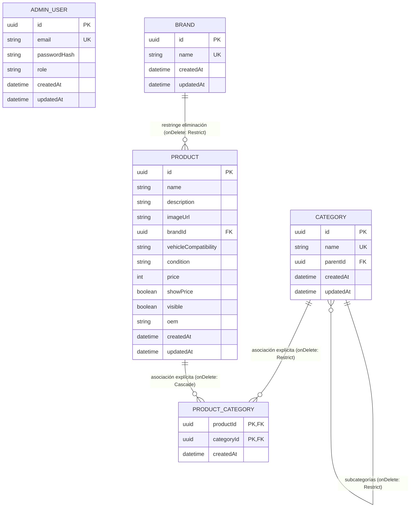

# Especificación — Fase 5: Backend, Base de Datos y Tubería de Archivos

**Fase:** 005-backend  
**Versión:** 1.1 (Consolidada con Resoluciones de Tech Lead, QA & AppSec)  
**Fecha:** 2026-10-19  
**Marco Normativo:** [docs/constitution.md](file:///f:/INGENIERIA/GEPI/InyectoresDiesel/docs/constitution.md), [AGENTS.MD](file:///f:/INGENIERIA/GEPI/InyectoresDiesel/AGENTS.MD)  
**Contratos Previos:** [specs/004-admin-panel/plan.md](file:///f:/INGENIERIA/GEPI/InyectoresDiesel/specs/004-admin-panel/plan.md) (Sección 4)  
**Estado:** Especificación Final Auditada

---

## 1. Contexto y Objetivo

### 1.1 Contexto

En la Fase 4 (Panel de Administración y Seguridad) se construyó la interfaz de administración (Backoffice) operando con un estado en memoria volátil de React Context y contratos de API estrictamente definidos bajo premisas Zero-Trust. Asimismo, se cuenta con una base de datos PostgreSQL 15 ejecutándose de manera aislada en contenedor Docker (`laboratorio_diesel_db`).

Para que el sistema sea completamente funcional y operativo en producción, es mandatorio reemplazar las estructuras simuladas del frontend por una capa de servidor autoritativa, relacional y blindada. Esta capa debe actuar como única fuente de verdad (Principio 5 de la Constitución), garantizando la integridad de los datos, el procesamiento seguro de imágenes y la protección de las operaciones de negocio del taller.

### 1.2 Objetivo de la Fase

Diseñar e implementar el servidor backend en **Node.js con Express y Prisma ORM**, ubicado de forma autónoma en el directorio `/server` y conectado a PostgreSQL, con los siguientes objetivos arquitectónicos:

1. **Reemplazo Transparente de Mocks:** Implementar los endpoints REST reales que consuman y entreguen exactamente los contratos definidos en la Sección 4 del plan de la Fase 4, mapeando las entidades en la capa de controladores/DTOs sin exigir cambios estructurales al frontend.
2. **Persistencia Relacional como Única Fuente de Verdad:** Modelar en PostgreSQL vía Prisma el esquema relacional para Administradores, Marcas, Categorías (con jerarquía de 1 nivel) y Productos mediante una tabla pivote explícita `ProductCategory`, aplicando restricciones de integridad referencial `onDelete: Restrict` innegociables tanto en el motor de base de datos como en la capa de servicio.
3. **Identidad y Sesiones Zero-Trust:** Administrar la autenticación mediante cookies `HttpOnly; Secure; SameSite=Strict` conteniendo tokens JWT firmados, almacenamiento de contraseñas con hashing **Argon2id**, y endpoints para login, logout y verificación de sesión silenciosa (`GET /api/auth/me`) para rehidratar el estado tras recargas de página (F5).
4. **Tubería Paranoica de Archivos (CDR):** Implementar una tubería de Desarme y Reconstrucción de Contenido (CDR) de 5 fases para imágenes de productos: recepción en memoria con Multer ($\le 5\text{ MB}$), verificación de lista blanca de extensiones, validación de Magic Bytes (`file-type`), prevención de bombas de descompresión (rechazo si excede $4096 \times 4096$ px), redimensionamiento acotado ($1080 \times 1080$ px `fit: 'inside'`), re-codificación forzada a formato `.webp` con `quality: 80` con Sharp (descartando metadatos EXIF) y renombrado a UUIDv4 opaco.
5. **Servicio Estático Público y Limpieza Física Segura:** Servir las imágenes en `/uploads` como activos públicos con cabeceras `nosniff`, y purgar físicamente los archivos reemplazados o eliminados del disco usando sanitización estricta de rutas (`path.basename`), de forma asíncrona y aislada sin interrumpir transacciones exitosas de base de datos.
6. **Defensa en Profundidad y Fail-Fast:** Validar todo dato de entrada mediante esquemas Zod en modo estricto (`.strict()`), proteger las rutas con cabeceras de seguridad (`helmet`), CORS de lista blanca estricta, limitadores de tasa (`express-rate-limit`) tanto en autenticación como en subida de archivos, y manejo centralizado de excepciones que distinga errores operativos (400/401 legibles) de errores no controlados (500 opacos con UUID).
7. **Aprovisionamiento Inicial (Seed):** Proveer un script de inicialización (`server/prisma/seed.ts`) que lea credenciales de administrador desde variables de entorno y siembre el catálogo base en la base de datos PostgreSQL.

### 1.3 Decisiones Arquitectónicas Consolidadas

| # | Decisión | Justificación y Regla de Negocio |
|---|----------|----------------------------------|
| **D-01** | **Backend Aislado en `/server` con `package.json` propio** | Evita la polución y colisión de dependencias y tipos entre React 19/Vite y Node.js/Express/Prisma. Mantiene responsabilidades acotadas. |
| **D-02** | **Archivo `.env` Único en Raíz** | Centraliza la configuración en un solo punto para Docker Compose, Vite (`VITE_*`) y Express (`../.env`). El archivo `.env.example` documentará todas las variables del backend. |
| **D-03** | **Tabla Pivote Explícita `ProductCategory` con `onDelete: Restrict`** | La relación M:N se modela de forma explícita para que PostgreSQL aplique la restricción foránea `RESTRICT`, impidiendo que se borre una categoría si tiene productos vinculados. |
| **D-04** | **Unicidad Global Case-Insensitive en Categorías** | No se permiten nombres de categorías duplicados en ningún nivel de la taxonomía, normalizando la comparación en minúsculas. |
| **D-05** | **Capa DTO/Serializer para Aplanado de `categoryIds`** | El controlador aplanará la relación `product.categories` para devolver estrictamente `categoryIds: string[]` preservando la compatibilidad con el frontend. |
| **D-06** | **Precio en Centavos / Entero Nativo (`Int`)** | Se utiliza el tipo `Int` en Prisma representando el valor entero en pesos argentinos, garantizando compatibilidad nativa con JSON sin problemas de serialización. |
| **D-07** | **Diferenciación de Errores: 400/401 Estructurados vs 500 Opacos** | Los errores de validación de formulario y credenciales devuelven mensajes legibles para la UI. Solo las excepciones internas no controladas (500) ocultan los detalles tras un UUID de referencia. |
| **D-08** | **Prevención de Bombas de Descompresión en Tubería CDR** | Se inspeccionan los metadatos de dimensiones antes de descomprimir el buffer. Imágenes que superen $4096 \times 4096$ píxeles se rechazan de inmediato para evitar colapsos por memoria RAM (OOM). |
| **D-09** | **Resize Acotado ($1080 \times 1080$) y Calidad Fija (80) en Sharp** | Reemplaza el peso límite fijo por parámetros deterministas de imagen óptimos para catálogo web. |
| **D-10** | **Prevención de Path Traversal y Resiliencia en `fs.unlink`** | Solo se extrae `path.basename(imageUrl)` para concatenar la ruta absoluta. La eliminación física se ejecuta en bloque `try/catch` post-commit; si falla la desvinculación en disco, se registra en logs pero la API responde `200 OK`. |
| **D-11** | **Rate Limiting Dedicado en Uploads** | Se implementa un limitador de tasa estricto (10 peticiones / 15 min) en `POST /api/uploads/product-image` para prevenir agotamiento de CPU por transcodificación masiva. |
| **D-12** | **Imágenes en `/uploads` como Activos Públicos** | Las imágenes servidas son recursos estáticos públicos del catálogo, protegidos con cabeceras `nosniff` y desactivación de scripts. |
| **D-13** | **Aceptación de Riesgo de Huérfanos por Abandono en MVP** | Las imágenes subidas que no lleguen a vincularse a un producto por abandono de formulario permanecen en disco durante este MVP (candidato a cronjob futuro). |

---

## 2. Requisitos Funcionales

### 2.1 Dominio: Autenticación y Sesión Zero-Trust

#### RF-01: Inicio de Sesión de Administrador
* **Descripción:** El backend debe autenticar las credenciales del administrador y establecer una cookie de sesión cifrada.
* **Criterios de Aceptación (EARS):**
  * **CA-01.1:** Cuando se reciba una petición `POST /api/auth/login`, el sistema debe validar el payload `{ email, password }` contra un esquema Zod `.strict()`.
  * **CA-01.2:** Si los datos no cumplen el esquema, el sistema debe retornar inmediatamente `400 Bad Request` con el detalle de validación:
    ```json
    {
      "error": "Datos de validación inválidos",
      "details": [{ "field": "email", "message": "Formato de correo electrónico inválido" }]
    }
    ```
  * **CA-01.3:** Si el usuario no existe o la contraseña no coincide al verificar el hash Argon2id, el sistema debe retornar `401 Unauthorized` con el mensaje:
    ```json
    { "error": "Credenciales inválidas" }
    ```
  * **CA-01.4:** Mientras las credenciales sean válidas, el sistema debe emitir un token JWT firmado (con tiempo de vida de 8 horas) e inyectarlo en la cabecera `Set-Cookie` con los atributos `HttpOnly; Secure; SameSite=Strict; Path=/; Max-Age=28800`.
  * **CA-01.5:** El sistema debe responder con código `200 OK` y el cuerpo JSON conteniendo `{ user: { id, email, role } }`.
  * **CA-01.6:** Si ocurre una excepción interna no controlada, el sistema debe registrar el stack internamente y devolver un error opaco `500` con referencia UUID (`{ error: "Error interno del servidor", referencia: "<uuid>" }`).

#### RF-02: Cierre de Sesión Seguro
* **Descripción:** El backend debe invalidar y destruir la cookie de sesión del administrador.
* **Criterios de Aceptación (EARS):**
  * **CA-02.1:** Cuando se reciba una petición `POST /api/auth/logout`, el sistema debe emitir una cabecera `Set-Cookie` con la clave de sesión vacía y `Max-Age=0` (`Path=/; HttpOnly; Secure; SameSite=Strict`).
  * **CA-02.2:** El sistema debe retornar `200 OK` con `{ success: true }`.

#### RF-03: Verificación de Sesión Activa (Sesión Silenciosa)
* **Descripción:** El backend debe validar la existencia y vigencia de la cookie de sesión para rehidratar el estado del cliente tras recargas (F5).
* **Criterios de Aceptación (EARS):**
  * **CA-03.1:** Cuando se reciba una petición `GET /api/auth/me`, el middleware de autenticación debe extraer y verificar la firma y vigencia del JWT contenido en la cookie.
  * **CA-03.2:** Si la cookie no está presente, está expirada o su firma es inválida, el sistema debe responder `401 Unauthorized` con `{ error: "Sesión no válida o expirada" }`.
  * **CA-03.3:** Si el JWT es válido y el usuario existe en la base de datos, el sistema debe responder `200 OK` con el perfil del usuario `{ id, email, role }`.

---

### 2.2 Dominio: Tubería de Archivos y CDR (Content Disarm and Reconstruction)

#### RF-04: Ingesta, Validación y Prevención de Bombas en Frontera
* **Descripción:** El backend debe recibir el archivo binario multipart en memoria, validar tipo, peso y dimensiones máximas.
* **Criterios de Aceptación (EARS):**
  * **CA-04.1:** Cuando se reciba una petición `POST /api/uploads/product-image`, la petición debe estar protegida por un limitador de tasa estricto (máximo 10 peticiones cada 15 minutos por IP).
  * **CA-04.2:** El archivo debe procesarse con `multer` configurado con almacenamiento exclusivo en memoria RAM (`storage: multer.memoryStorage()`) y límite de tamaño fijado en $5\,242\,880$ bytes (5 MB exactos).
  * **CA-04.3:** Si el payload excede los 5 MB o no contiene el campo `file`, el sistema debe responder inmediatamente `400 Bad Request`.
  * **CA-04.4:** Si el nombre del archivo no posee una extensión permitida (`.jpg`, `.jpeg`, `.png`, `.webp`), el sistema debe abortar el procesamiento con `400 Bad Request`.
  * **CA-04.5:** El sistema debe analizar los Magic Bytes del buffer de memoria mediante `file-type`. Si el tipo MIME real no coincide con `image/jpeg`, `image/png` o `image/webp`, el sistema debe rechazar el archivo con `400 Bad Request`.
  * **CA-04.6:** El sistema debe leer los metadatos de cabecera de la imagen mediante `sharp(buffer).metadata()`. Si el ancho (`width`) o el alto (`height`) superan los $4096$ píxeles, el sistema debe abortar de inmediato con `400 Bad Request` informando `"Dimensiones de imagen excesivas (máximo 4096x4096 píxeles)"`, evitando ataques de consumo de memoria (Pixel Flood).

#### RF-05: Desarme, Reconstrucción (Sharp) y Almacenamiento Seguro
* **Descripción:** El backend debe sanitizar la imagen re-codificándola a WebP optimizado y almacenarla con nombre opaco.
* **Criterios de Aceptación (EARS):**
  * **CA-05.1:** El sistema debe procesar el buffer validado a través de `sharp`, aplicando un redimensionamiento acotado a un máximo de $1080 \times 1080$ píxeles con la opción `{ fit: 'inside', withoutEnlargement: true }`.
  * **CA-05.2:** El procesamiento con Sharp debe forzar la conversión a formato `.webp` con `quality: 80`, despojando forzosamente todos los metadatos EXIF, perfiles de color incrustados y cualquier segmento de datos binarios arbitrarios.
  * **CA-05.3:** El sistema debe generar un identificador criptográfico único mediante `crypto.randomUUID()` y persistir la imagen reconstruida en el directorio `server/uploads/<uuid>.webp`.
  * **CA-05.4:** El sistema debe responder `201 Created` con el cuerpo `{ imageUrl: "/uploads/<uuid>.webp" }`.

#### RF-06: Servicio Estático Blindado y Limpieza Física Resiliente
* **Descripción:** El backend debe servir los archivos procesados como activos estáticos y purgar los archivos eliminados del disco de forma segura.
* **Criterios de Aceptación (EARS):**
  * **CA-06.1:** Cuando se solicite una imagen bajo `/uploads/*`, el middleware de servicio estático debe inyectar las cabeceras `X-Content-Type-Options: nosniff`, `Cross-Origin-Resource-Policy: cross-origin` y deshabilitar cualquier cabecera que permita la interpretación de scripts.
  * **CA-06.2:** Cuando un producto sea eliminado de la base de datos o su `imageUrl` sea modificada por otra ruta de imagen, el sistema debe proceder a la eliminación física del archivo anterior del disco **únicamente tras** la confirmación exitosa de la mutación en PostgreSQL.
  * **CA-06.3:** Para prevenir vulnerabilidades de *Path Traversal*, el sistema debe extraer estrictamente el nombre base seguro del archivo mediante `path.basename(oldImageUrl)` y construir la ruta de borrado concatenándola con la carpeta absoluta de subidas.
  * **CA-06.4:** La operación de borrado físico (`fs.promises.unlink`) debe ejecutarse dentro de un bloque `try/catch` aislado. Si la desvinculación falla (por ejemplo por bloqueo de archivo en Windows `EBUSY` o archivo inexistente), el sistema debe registrar una advertencia estructurada en logs internos y **retornar igualmente `200 OK`** al cliente, preservando el éxito de la operación de negocio en base de datos.

---

### 2.3 Dominio: CRUD de Catálogo e Integridad Relacional

#### RF-07: Gestión de Productos (ABM Completo)
* **Descripción:** El backend debe permitir listar, crear, modificar y eliminar repuestos con persistencia relacional.
* **Criterios de Aceptación (EARS):**
  * **CA-07.1:** Cuando se solicite `GET /api/products`, el sistema debe retornar la colección completa de productos en un array JSON plano. La capa DTO del controlador debe transformar la relación `productCategories` para entregar la lista plana `categoryIds: string[]` y `brandId: string`, garantizando compatibilidad 100% con el frontend.
  * **CA-07.2:** Cuando se reciba `POST /api/products`, el sistema debe validar el body con `productFormSchema.strict()`. Si es válido, debe crear el producto en PostgreSQL vinculando la marca y creando los registros correspondientes en la tabla intermedia `ProductCategory`, retornando `201 Created` con la entidad normalizada.
  * **CA-07.3:** Cuando se reciba `PUT /api/products/:id`, el sistema debe verificar la existencia del producto. Si existe y el body es válido, debe actualizar sus campos y sincronizar la tabla intermedia `ProductCategory` dentro de una transacción Prisma, retornando `200 OK`.
  * **CA-07.4:** Cuando se reciba `PATCH /api/products/:id/visibility`, el sistema debe exigir un body `{ visible: boolean }`. Si es válido, debe actualizar el campo booleano y retornar la entidad actualizada.
  * **CA-07.5:** Cuando se reciba `DELETE /api/products/:id`, el sistema debe eliminar en una transacción el producto y sus filas en `ProductCategory`, procediendo luego a la limpieza física de la imagen asociada (CA-06.2, CA-06.4).
  * **CA-07.6:** Todas las operaciones de mutación (`POST`, `PUT`, `PATCH`, `DELETE`) deben exigir que la petición provenga de una sesión autenticada con rol `admin` y contenga la cabecera `X-Requested-With: XMLHttpRequest`.

#### RF-08: Gestión de Categorías y Subcategorías (Jerarquía de 1 Nivel)
* **Descripción:** El backend debe administrar la taxonomía jerárquica con restricción de anidamiento estricta e integridad referencial forzada.
* **Criterios de Aceptación (EARS):**
  * **CA-08.1:** Cuando se solicite `GET /api/categories`, el sistema debe retornar la lista de categorías incluyendo `id`, `name` y `parentId`.
  * **CA-08.2:** Cuando se reciba `POST /api/categories`, el sistema debe validar que `name` sea único a nivel global (insensible a mayúsculas/minúsculas). Si se especifica `parentId`, debe comprobar que la categoría padre referenciada sea raíz (`parentId === null`), impidiendo un segundo nivel de anidamiento.
  * **CA-08.3:** Cuando se reciba `PUT /api/categories/:id`, el sistema debe impedir la auto-asignación (`parentId !== id`) y bloquear la asignación de un padre si la categoría en edición ya posee subcategorías hijas.
  * **CA-08.4:** Cuando se reciba `DELETE /api/categories/:id`, el sistema debe rechazar la eliminación con `409 Conflict` si la categoría posee subcategorías hijas vinculadas o si tiene uno o más productos asociados en la tabla `ProductCategory` (`onDelete: Restrict`).

#### RF-09: Gestión de Marcas
* **Descripción:** El backend debe administrar los fabricantes de repuestos y proteger su integridad referencial.
* **Criterios de Aceptación (EARS):**
  * **CA-09.1:** Cuando se solicite `GET /api/brands`, el sistema debe retornar la lista de marcas ordenadas alfabéticamente.
  * **CA-09.2:** Cuando se reciba `POST /api/brands`, el sistema debe validar unicidad de nombre de forma insensible a mayúsculas/minúsculas (*case-insensitive*) y persistir la marca.
  * **CA-09.3:** Cuando se reciba `DELETE /api/brands/:id`, el sistema debe rechazar la eliminación con `409 Conflict` si la marca se encuentra asignada a al menos un producto en la base de datos (`onDelete: Restrict`).

#### RF-10: Métricas del Catálogo (Dashboard)
* **Descripción:** El backend debe proveer los contadores agregados para el panel de administración.
* **Criterios de Aceptación (EARS):**
  * **CA-10.1:** Cuando un administrador autenticado solicite `GET /api/admin/metrics`, el sistema debe ejecutar consultas agregadas en PostgreSQL y retornar:
    ```json
    {
      "totalProducts": 4,
      "visibleProducts": 3,
      "hiddenProducts": 1,
      "totalCategories": 6,
      "totalBrands": 3
    }
    ```

#### RF-11: Aprovisionamiento y Sembrado de Datos (Seed Script)
* **Descripción:** El sistema debe contar con un script automatizado para la creación del superadministrador inicial y el catálogo base.
* **Criterios de Aceptación (EARS):**
  * **CA-11.1:** El script `server/prisma/seed.ts` debe leer de forma obligatoria las variables `ADMIN_INITIAL_EMAIL` y `ADMIN_INITIAL_PASSWORD` del archivo `.env` raíz. Si no están definidas, debe abortar con un error explícito.
  * **CA-11.2:** El script debe hashear la contraseña inicial utilizando exclusivamente **Argon2id** e insertar/actualizar (*upsert*) el usuario administrador en PostgreSQL.
  * **CA-11.3:** El script debe insertar idempotentemente las categorías, marcas y productos semilla iniciales definidos en `src/lib/admin-seed-data.ts`.

---

## 3. Modelo de Datos Lógico (PostgreSQL + Prisma)

### 3.1 Diagrama Entidad-Relación



### 3.2 Especificación de Entidades

#### 1. Entidad `AdminUser`
* `id`: UUID (Primary Key, default `gen_random_uuid()`).
* `email`: String (Unique, indexado, normalizado en minúsculas).
* `passwordHash`: String (Hash generado con Argon2id, nunca expuesto).
* `role`: String (Valor constante `'admin'`).
* `createdAt` / `updatedAt`: DateTime.

#### 2. Entidad `Brand`
* `id`: UUID (Primary Key, default `gen_random_uuid()`).
* `name`: String (Unique, insensible a mayúsculas, $\ge 2$ caracteres).
* `products`: Relación 1:N hacia `Product` con regla `onDelete: Restrict`.
* `createdAt` / `updatedAt`: DateTime.

#### 3. Entidad `Category`
* `id`: UUID (Primary Key, default `gen_random_uuid()`).
* `name`: String (Unique global, insensible a mayúsculas, $\ge 2$ caracteres).
* `parentId`: UUID (Nullable, Foreign Key hacia `Category.id` con regla `onDelete: Restrict`).
* `parent`: Relación N:1 auto-referenciada.
* `children`: Relación 1:N auto-referenciada.
* `productCategories`: Relación 1:N hacia tabla pivote `ProductCategory` con regla `onDelete: Restrict`.
* `createdAt` / `updatedAt`: DateTime.

#### 4. Entidad `Product`
* `id`: UUID (Primary Key, default `gen_random_uuid()`).
* `name`: String ($\ge 3$ caracteres).
* `description`: Text ($\ge 5$ caracteres).
* `imageUrl`: String (Ruta relativa sanitizada `/uploads/<uuid>.webp`).
* `brandId`: UUID (Foreign Key hacia `Brand.id`, `onDelete: Restrict`).
* `vehicleCompatibility`: String (Opcional, texto libre).
* `condition`: String o Enum (`'Nuevo'`, `'Reacondicionado'`, `'Usado'`).
* `price`: Int (Entero nativo en pesos ARS, admite `null` para productos "A cotizar" o `0`).
* `showPrice`: Boolean (Default `true`).
* `visible`: Boolean (Default `true`, indexado para filtros de catálogo público).
* `oem`: String (Opcional, código de fabricante/repuesto).
* `productCategories`: Relación 1:N hacia tabla pivote `ProductCategory` con regla `onDelete: Cascade`.
* `createdAt` / `updatedAt`: DateTime.

#### 5. Tabla Pivote Explícita `ProductCategory`
* `productId`: UUID (Foreign Key hacia `Product.id`, `onDelete: Cascade`).
* `categoryId`: UUID (Foreign Key hacia `Category.id`, `onDelete: Restrict`).
* Clave primaria compuesta: `@@id([productId, categoryId])`.
* `createdAt`: DateTime (Default `now()`).

---

## 4. Requisitos de Seguridad Innegociables (Zero-Trust & AppSec)

Alineado de forma estricta con `AGENTS.MD` y `docs/constitution.md`:

### 4.1 Identidad, Criptografía y Sesiones Blindadas
* **Argon2id Obligatorio:** Queda prohibido el uso de bcrypt, scrypt o SHA. Las contraseñas se procesan con `argon2` variante Argon2id (mínimo 64 MB de memoria, 3 iteraciones, paralelismo 1).
* **JWT Exclusivo en Cookie HttpOnly:** Ningún token de acceso se expone al JavaScript del cliente. El JWT viaja exclusivamente en cookie con las banderas:
  * `HttpOnly`: Mitigación total de robo por XSS.
  * `Secure`: Transmisión sobre HTTPS en producción.
  * `SameSite=Strict`: Mitigación nativa de CSRF.
  * `Path=/` y tiempo de vida estricto de 8 horas (`Max-Age=28800`).

### 4.2 Fronteras de Validación Fail-Fast (Zod)
* Todo endpoint receptor de datos (`body`, `params`, `query`) debe validar la entrada a través de un esquema Zod en modo `.strict()`.
* Si la carga entrante contiene propiedades no declaradas o tipos incompatibles, el middleware debe abortar la ejecución inmediatamente retornando `400 Bad Request`.

### 4.3 Control de Origen (CORS) y Protección Anti-CSRF
* **CORS Restrictivo:** Prohibido el uso de comodines (`*`). La cabecera `Access-Control-Allow-Origin` debe configurarse explícitamente con el valor proveniente de `CORS_ORIGIN`.
* `credentials: true`: Habilitado para permitir la recepción y emisión de cookies de sesión entre el cliente Vite y el servidor Express.
* **Cabecera Anti-CSRF:** En todas las peticiones mutables (`POST`, `PUT`, `PATCH`, `DELETE`), el backend debe verificar la presencia de la cabecera personalizada `X-Requested-With: XMLHttpRequest`.

### 4.4 Mitigación de Denegación de Servicio y Cabeceras Defensivas
* **Rate Limiting Diferenciado (`trust proxy: 1`):**
  * `/api/auth/login`: Máximo 5 intentos fallidos por ventana de 15 minutos por dirección IP.
  * `/api/uploads/product-image`: Máximo 10 peticiones por ventana de 15 minutos por dirección IP.
* **Helmet:** Inyección de middlewares de seguridad de cabeceras HTTP (`helmet`) en la aplicación Express para desactivar `X-Powered-By` y prevenir ataques de clickjacking y mime-sniffing.

### 4.5 Manejo de Errores: Operativos vs Opacos
* **Errores Operativos (400, 401, 404, 409):** Devuelven respuestas estructuradas y legibles para que la interfaz de usuario pueda presentar retroalimentación clara al usuario o formulario.
* **Errores No Controlados (500 Internal Server Error):** En estricto cumplimiento con el Principio 6 de la Constitución, el middleware global registra el detalle técnico completo (stack trace, sentencias SQL) asociado a un UUID unívoco y responde de forma opaca al cliente:
  ```json
  {
    "error": "Error interno del servidor",
    "referencia": "f81d4fae-7dec-11d0-a765-00a0c91e6bf6"
  }
  ```
  Jamás se filtrarán detalles internos de base de datos o trazas de ejecución al exterior.

### 4.6 Validación Temprana del Entorno (Crash Early)
* Al arrancar el servidor Express, un módulo de validación Zod debe comprobar la presencia y formato de todas las variables críticas:
  * `PORT`
  * `DATABASE_URL`
  * `JWT_SECRET` (mínimo 32 caracteres criptográficos)
  * `CORS_ORIGIN`
* Si alguna variable requerida falta o es inválida, el proceso de Node.js debe terminar inmediatamente (`process.exit(1)`).
* El plan técnico de esta fase (`plan.md`) requerirá actualizar el archivo `.env.example` de la raíz con todas estas variables para que la plantilla de desarrollo quede 100% sincronizada.

---

## 5. Fuera de Alcance (Out of Scope)

1. **Autenticación de Clientes / Compradores:** La plataforma no dispone de registro ni inicio de sesión para el público general.
2. **Pasarelas de Pago Online y Checkout:** No se integran plataformas como Mercado Pago o Stripe.
3. **Almacenamiento en la Nube (AWS S3, Cloudinary, etc.):** El almacenamiento de archivos se mantiene local en disco (`server/uploads/`) protegido mediante la tubería CDR.
4. **Limpieza Automatizada de Imágenes Huérfanas por Abandono:** Las imágenes subidas sin producto asociado quedan en disco durante el MVP; su purga automatizada mediante cronjob queda diferida a fases operativas posteriores.
5. **Paginación Compleja o Servidores de Búsqueda Dedicados:** No se implementan motores externos. Las consultas operan de forma directa sobre PostgreSQL.
6. **Múltiples Roles de Usuario:** Se contempla un rol único de `'admin'`.
7. **Múltiples Niveles de Jerarquía de Categorías:** Se mantiene la regla estricta de exactamente 1 nivel (Categoría Raíz $\rightarrow$ Subcategoría Hija).
