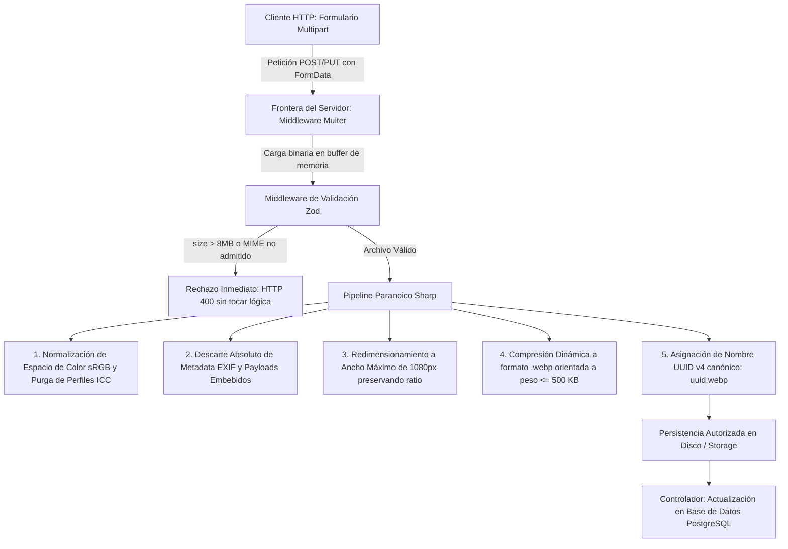
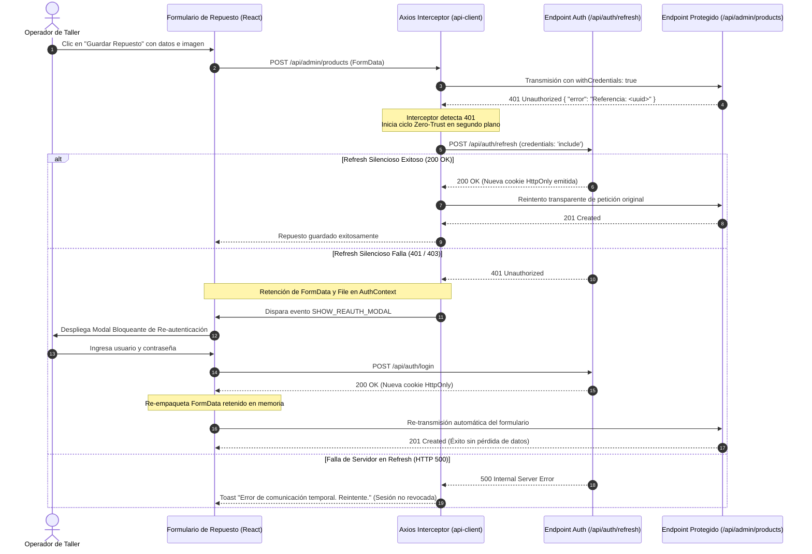

# Plan de Implementación Técnica — Spec 010: Retro-documentación y Refinamiento del Rediseño UI Premium

**Fase:** 010-rediseño-premium  
**Fecha:** 2026-10-22  
**Estado:** Documento de Arquitectura y Plan Técnico Homologado  
**Basado en:** [specs/010-rediseño-premium/spec.md](file:///f:/INGENIERIA/GEPI/InyectoresDiesel/specs/010-redise%C3%B1o-premium/spec.md) y [docs/constitution.md](file:///f:/INGENIERIA/GEPI/InyectoresDiesel/docs/constitution.md)  

---

## 1. Estructura de Directorios y Archivos

### 1.1 Mapeo de Archivos a Crear y Modificar

| Tipo | Archivo / Componente | Acción | Justificación Arquitectónica y Cobertura (RF / RNF / Constitución) |
| :--- | :--- | :--- | :--- |
| **Config / Estilos** | `src/styles.css` | **Modificar** | Incorporación de los tokens canónicos en variables CSS nativas (`:root`), utilidades para keyframes CSS puros de marquesina (`marquee-slide`), haz de luz (`shimmer-pass`), máscara perimetral y soporte de `js-enabled` para degradación elegante. *(Cubre: RF-01, RF-02, RF-05, RNF-01, Principio 1)* |
| **Config / Estilos** | `tailwind.config.js` | **Modificar** | Registro de la paleta canónica (naranja industrial `#ea580c`, zinc-500 `#71717a`, superficies `#0a0a0a` / `#111111` / `#1c1c1e`) y matriz de breakpoints (`sm: 640px`, `md: 768px`, `lg: 1024px`, `xl: 1280px`, `2xl: 1536px`). *(Cubre: Apéndice 10, RF-07, Principio 1)* |
| **Componente Landing** | `src/components/landing/BrandsMarquee.tsx` | **Modificar** | Implementación de clonación dinámica con `min-width: 200vw`, recálculo por `ResizeObserver`, botón accesible toggle para WCAG 2.2.2, filtro monocromático `brightness-0 invert opacity-70` y desmontaje ante estado vacío. *(Cubre: RF-01, RNF-02)* |
| **Componente UI** | `src/components/ui/CatalogCTAButton.tsx` | **Crear** | Componente unificado para los botones "Ver Catálogo" del Navbar, Hero y Barra Móvil. Contiene contenedor estático, haz de luz a 45° en ciclo de 5.2s (4.0s reposo + 1.2s barrido `ease-in-out`), micro-desplazamiento autónomo de flecha (0 a 4px en 1.5s), compresión física `scale-[0.98]` en `:active` de escritorio y cancelación con `prefers-reduced-motion`. *(Cubre: RF-02)* |
| **Componente Landing** | `src/components/landing/HeroSection.tsx` | **Modificar** | Reordenamiento de jerarquía: "LABORATORIO DIÉSEL" con entrada *fade-in slide-up* en 0.8s, seguido tras 800ms por el subtítulo con mecanografía técnica y cursor parpadeante permanente en naranja `#ea580c`. Integración de `CatalogCTAButton`. *(Cubre: RF-03)* |
| **Componente Landing** | `src/components/landing/LandingNavbar.tsx` | **Modificar** | Reemplazo del botón estático de catálogo por `CatalogCTAButton` y armonización cromática con bordes de 1px translúcidos. *(Cubre: RF-02)* |
| **Componente Landing** | `src/components/landing/MobileStickyBar.tsx` | **Crear** | Barra inferior persistente en `< 768px` condicionada a `pathname === '/'`, altura mínima flexible `min-h-[64px]`, borde superior `border-white/10`, botón de WhatsApp centrado de 48px exactos, `CatalogCTAButton` en `flex-1`, ocultamiento en modo landscape (`< 450px`) y medición dinámica por `ResizeObserver` para inyectar `--bottom-bar-height`. *(Cubre: RF-07, RNF-03)* |
| **Componente Landing** | `src/components/landing/LandingFooter.tsx` | **Modificar** | Erradicación total de azules, adopción de naranja industrial, e inserción de "Desarrollada por GEPI SOFTWARE" con hipervínculo seguro abriendo en la misma pestaña (`_self`). *(Cubre: RF-06)* |
| **Componentes Landing** | `src/components/landing/*.tsx` | **Modificar** | Retiro de clases de desaturación a escala de grises (`grayscale`, `filter`) en fotos de taller, preservación de degradados neutros protectores WCAG AA, y adición de animaciones *fade-in slide-up* escalonadas (`stagger: 0.1s - 0.2s`) con activación única (`once: true`) y fallback condicional `js-enabled`. *(Cubre: RF-04, RF-05, RNF-01)* |
| **Componente Catálogo** | `src/components/catalog/ProductCard.tsx` | **Modificar** | Contenedor de fotografía cuadrado 1:1 (`aspect-square`) con fondo `#1c1c1e` y marco interno de 16px. Integración de fotos con fondo blanco como polaroids (`rounded-md` y `object-contain` sin `multiply`), renderizado de isotipo vectorial al 20% de opacidad (`opacity-20`) ante imágenes faltantes, y diferenciación cromática de badges ("Nuevo" en `#ea580c` vs "Reacondicionado" en `#71717a`). *(Cubre: RF-08)* |
| **Layout Público** | `src/routes/__root.tsx` / Layout | **Modificar** | Inyección de la clase `js-enabled` en `<html>`, suscripción a variable CSS `--bottom-bar-height` para compensación condicional del padding inferior en `pathname === '/'`. *(Cubre: RF-05, RF-07)* |
| **Componente Admin** | `src/components/admin/products/ProductList.tsx` | **Modificar** | Cabeceras de tabla fijas (*sticky headers*) con fondo 100% opaco (`#ffffff`) y demarcación inferior `box-shadow: 0 1px 0 rgba(0,0,0,0.10)`. Tipografía monoespaciada de alto contraste para códigos OEM, botones en naranja técnico `#ea580c` con hover `#c2410c`, y manejo opaco de errores 500 (`"Error del servidor. Referencia: <uuid>"`). *(Cubre: RF-09, Principio 5, Principio 6)* |
| **Componente Admin** | `src/components/admin/products/DeleteConfirmModal.tsx` | **Crear** | Modal bloqueante para eliminación de repuestos: botón deshabilitado que exige tipear la palabra exacta "ELIMINAR" (*case-sensitive* + `.trim()`), interceptación de `Enter` en `onSubmit`, y bloqueo de autocompletado del navegador (`autoComplete="off"`, etc.). *(Cubre: RF-09)* |
| **Contexto React** | `src/context/AuthContext.tsx` | **Modificar** | Manejo de sesión Zero-Trust con soporte para retención de formulario y archivo `File` en memoria durante fallos de sesión, orquestación del modal bloqueante de re-autenticación ante expiración de refresh, y sincronización multi-pestaña mediante `BroadcastChannel` con fallback a `storage`. *(Cubre: Caso Límite 8, Caso Límite 9, Principio 4)* |
| **Hooks / Estado** | `src/hooks/useUnsavedChangesWarning.ts` | **Crear** | Hook para activar preventivamente `beforeunload` cuando existan formularios sucios o cuando el modal bloqueante de re-autenticación esté abierto, previniendo pérdida de trabajo por F5 o cierre accidental. *(Cubre: Caso Límite 10)* |
| **Servicio HTTP** | `src/lib/api-client.ts` | **Modificar** | Configuración obligatoria de `withCredentials: true` en Axios. Interceptor de respuestas para capturar HTTP 401, ejecutar refresh silencioso contra `/api/auth/refresh`, reintentar la petición original transparentemente, retener el `FormData` binario si el refresh falla y lanzar el modal bloqueante. Manejo de excepciones de red pura (`Network Error`) y desacoplamiento de errores 500 opacos. *(Cubre: Caso Límite 8, Caso Límite 11, Caso Límite 12, Principio 4, Principio 6)* |
| **Middleware Servidor** | `server/src/middleware/upload.middleware.ts` | **Modificar** | Pipeline paranoico Sharp: Multer en memoria (`memoryStorage`) con límite físico de 8 MB. Validación Zod en frontera (`mimetype` permitido y `size <= 8000000`). Invocación de Sharp para redimensionar a 1080px, purgar metadatos EXIF, purgar perfiles ICC normalizando a sRGB, renombrar a UUID v4 (`<uuid>.webp`) y compresión dinámica de salida a `<= 500 KB`. *(Cubre: RNF-04, Principio 2, Principio 3)* |
| **Middleware Servidor** | `server/src/middleware/error.middleware.ts` | **Modificar** | Estandarización constitucional estricta de respuestas: todo fallo emite `{ "error": "Referencia: <uuid>" }` con código HTTP genérico (incluyendo 401 y 500), registrando el stack y contexto únicamente en logs estructurados internos. *(Cubre: Caso Límite 4, Caso Límite 13, Principio 6)* |

---

## 2. Modelo de Diseño y Tokens

### 2.1 Definición Canónica de Variables CSS (`src/styles.css`) *(Cubre: Apéndice 10, RF-08, RF-09, Principio 1)*

```css
:root {
  /* ==========================================================================
     Entorno Público (Landing Page y Catálogo) — Modo Oscuro Premium
     ========================================================================== */
  --surface-canvas: #0a0a0a;          /* Fondo base inerte de la página */
  --surface-card: #111111;            /* Fondo de tarjetas y módulos */
  --surface-media: #1c1c1e;           /* Fondo de cajas cuadradas 1:1 de fotos */
  --border-subtle: rgba(255, 255, 255, 0.10); /* Borde perimetral estándar de 1px */
  --border-hover: rgba(255, 255, 255, 0.25);  /* Borde de tarjeta al hacer hover */
  --shimmer-beam: rgba(255, 255, 255, 0.15);  /* Haz de luz diagonal en botones */
  
  --text-primary: #f3f4f6;            /* Títulos, códigos OEM y llamadas a acción */
  --text-muted: #a1a1aa;              /* Subtítulos técnicos y firma institucional */
  
  --accent-action: #ea580c;           /* Naranja Industrial / Calor Diésel */
  --accent-hover: #f97316;            /* Hover y estado activo de acento */
  --badge-refurbished: #71717a;       /* Gris Metalizado Técnico para Reacondicionados */
  --channel-support: #22c55e;         /* Isotipo del canal WhatsApp */

  /* ==========================================================================
     Entorno Operativo (Panel de Administración) — Modo Claro SaaS
     ========================================================================== */
  --admin-bg: #f9fafb;                /* Fondo general del Backoffice */
  --admin-surface: #ffffff;           /* Tablas, modales y tarjetas (100% opaco) */
  --admin-border: #e5e7eb;            /* Bordes de tablas e inputs */
  --admin-header-shadow: 0 1px 0 rgba(0, 0, 0, 0.10); /* Sombra de sticky header */
  
  --admin-text-main: #111827;         /* Texto principal y datos de inventario */
  --admin-text-sub: #4b5563;          /* Etiquetas de formulario y metadatos */
  
  --admin-btn-primary: #ea580c;       /* Botón de acción primaria (Guardar, Crear) */
  --admin-btn-primary-hover: #c2410c; /* Hover de botón primario en Admin */
  --admin-btn-secondary: #6b7280;     /* Botón secundario u outline */
  --admin-btn-danger: #dc2626;        /* Botón destructivo (Eliminar) */

  /* Dinámica de Layout Móvil */
  --bottom-bar-height: 64px;          /* Altura base recalculada por ResizeObserver */
}
```

### 2.2 Integración en `tailwind.config.js` *(Cubre: Apéndice 10.3, RF-07, Principio 1)*

```javascript
module.exports = {
  theme: {
    screens: {
      'sm': '640px',
      'md': '768px',   // Límite Canónico: transición móvil a escritorio
      'lg': '1024px',
      'xl': '1280px',
      '2xl': '1536px',
    },
    extend: {
      colors: {
        canvas: 'var(--surface-canvas)',
        card: 'var(--surface-card)',
        media: 'var(--surface-media)',
        industrial: {
          DEFAULT: 'var(--accent-action)',
          hover: 'var(--accent-hover)',
          dark: 'var(--admin-btn-primary-hover)',
        },
        mutedText: 'var(--text-muted)',
      },
      keyframes: {
        'marquee-half': {
          '0%': { transform: 'translateX(0%)' },
          '100%': { transform: 'translateX(-50%)' },
        },
        'shimmer-slide': {
          '0%': { transform: 'translateX(-150%) rotate(45deg)' },
          '23.07%': { transform: 'translateX(150%) rotate(45deg)' }, /* 1.2s / 5.2s = 23.07% */
          '100%': { transform: 'translateX(150%) rotate(45deg)' },   /* 4.0s de reposo */
        },
        'arrow-oscillate': {
          '0%, 100%': { transform: 'translateX(0px)' },
          '50%': { transform: 'translateX(4px)' },
        },
      },
      animation: {
        'marquee': 'marquee-half 35s linear infinite',
        'shimmer': 'shimmer-slide 5.2s ease-in-out infinite',
        'arrow': 'arrow-oscillate 1.5s ease-in-out infinite',
      },
    },
  },
};
```

---

## 3. Contratos de API y Pipeline de Archivos

### 3.1 Arquitectura del Pipeline de Carga (Multer + Zod + Sharp) *(Cubre: RNF-04, Principios 2 y 3)*



#### Contrato del Schema Zod en Frontera (`uploadSchema`)
```typescript
import { z } from 'zod';

export const uploadFileSchema = z.object({
  mimetype: z.enum(['image/jpeg', 'image/png', 'image/webp'], {
    errorMap: () => ({ message: 'Formato no admitido. Se requiere JPEG, PNG o WebP' }),
  }),
  size: z.number().max(8_000_000, {
    message: 'El tamaño de archivo entrante no debe exceder 8 MB',
  }),
});
```

#### Especificación del Procesamiento en Sharp (`SharpPipeline`)
1. **Entrada:** Buffer directo en memoria desde `req.file.buffer`.
2. **Métodos:**
   ```typescript
   sharp(buffer)
     .rotate() // Autocorrección de orientación EXIF antes del descarte
     .resize({ width: 1080, withoutEnlargement: true })
     .toColorspace('srgb') // Normalización sRGB y purga de perfiles ICC embebidos
     .webp({ quality: 80, effort: 6 })
   ```
3. **Control de Bucle de Compresión:** Si el buffer resultante sobrepasa los 500 KB (500,000 bytes), se reduce progresivamente la calidad (`quality: 65`, `quality: 50`) hasta satisfacer estrictamente el límite constitucional `<= 500 KB`.
4. **Almacenamiento:** Escritura en disco bajo `<randomUUID()>.webp`. Nunca se sirve ni retiene el nombre original provisto por el usuario.

### 3.2 Contratos Constitucionales de Respuestas de Error (Principio 6: Errores Opacos) *(Cubre: Caso Límite 4, Caso Límite 13)*

Toda respuesta de error emitida por el servidor (middleware `error.middleware.ts`) respetará el contrato constitucional sin variaciones ni campos informativos legibles adicionales:

#### 1. Fallo de Autenticación / Expiración de Sesión (HTTP 401)
- **Status Code:** `401 Unauthorized`
- **Headers:** `Content-Type: application/json`
- **Body:**
  ```json
  {
    "error": "Referencia: a1b2c3d4-e5f6-7a8b-9c0d-1e2f3a4b5c6d"
  }
  ```

#### 2. Fallo Interno del Servidor o Caída de Base de Datos (HTTP 500)
- **Status Code:** `500 Internal Server Error`
- **Headers:** `Content-Type: application/json`
- **Body:**
  ```json
  {
    "error": "Referencia: f9e8d7c6-b5a4-3210-fedc-ba9876543210"
  }
  ```
- **Comportamiento en Frontend:** El cliente intercepta el cuerpo JSON, extrae la cadena `"Referencia: <uuid>"` y proyecta en la UI el mensaje opaco: `"Error del servidor. Referencia: <uuid>"`, manteniendo la auditoría interna mediante el UUID mientras oculta al exterior la traza técnica real.

---

## 4. Lógica de Estado y Sesión (Arquitectura del Cliente)

### 4.1 Ciclo de Intercepción de Peticiones y Refresh Silencioso (`src/lib/api-client.ts`) *(Cubre: Caso Límite 8, Caso Límite 11, Principio 4)*



### 4.2 Sincronización Multi-Pestaña de Sesión (`src/context/AuthContext.tsx`) *(Cubre: Caso Límite 9)*

Para sincronizar el cierre o revocación de sesión en tiempo real entre múltiples pestañas abiertas del Backoffice:
1. **Canal Principal (`BroadcastChannel`):** Se instancia un canal denominado `'auth_channel'`.
2. **Mensajes:**
   - `{ type: 'SESSION_REVOKED' }`: Emitido cuando una pestaña detecta que el refresh silencioso falló definitivamente o el usuario pulsó "Cerrar sesión".
   - `{ type: 'SESSION_RESTORED' }`: Emitido tras un login exitoso en el modal bloqueante.
3. **Mecanismo de Fallback (`storage` event):** Para entornos que restringen `BroadcastChannel`, se suscribe un listener a `window.addEventListener('storage')` que escucha cambios en una clave efímera de señalización (`auth_sync_timestamp`).
4. **Efecto Inmediato:** Al recibir `SESSION_REVOKED`, todas las pestañas inactivas invalidan su estado en memoria, previniendo que el operador interactúe con datos caducados.

### 4.3 Prevención de Pérdida Accidental de Trabajo (`src/hooks/useUnsavedChangesWarning.ts`) *(Cubre: Caso Límite 10)*

```typescript
// Pseudocódigo arquitectónico del Hook
export function useUnsavedChangesWarning(isDirty: boolean, isModalOpen: boolean) {
  useEffect(() => {
    const handleBeforeUnload = (e: BeforeUnloadEvent) => {
      if (isDirty || isModalOpen) {
        e.preventDefault();
        e.returnValue = ''; // Dispara confirmación estándar del navegador
      }
    };
    window.addEventListener('beforeunload', handleBeforeUnload);
    return () => window.removeEventListener('beforeunload', handleBeforeUnload);
  }, [isDirty, isModalOpen]);
}
```

---

## 5. Algoritmos y Cinemática

### 5.1 Algoritmo de Cobertura Dinámica del Marquee (`BrandsMarquee.tsx`) *(Cubre: RF-01)*

#### Problema Físico
Si la base de datos devuelve pocas marcas (ej. 4 marcas con ancho de 120px + 48px gap = 672px), en una pantalla 4K (3840px) se producirá un espacio en blanco si solo se clona 3 veces.

#### Algoritmo
1. **Medición del Ancho del Viewport:** Se obtiene `const viewportWidth = window.innerWidth`.
2. **Medición del Ancho de un Conjunto Base:** Se calcula la longitud total de la lista original de marcas:
   $$\text{singleSetWidth} = \text{marcas.length} \times (120\text{px} + 48\text{px})$$
3. **Determinación del Multiplicador de Clones:**
   $$\text{targetWidth} = \text{viewportWidth} \times 2 \quad (200vw)$$
   $$\text{multiplier} = \max\left(2, \left\lceil \frac{\text{targetWidth}}{\text{singleSetWidth}} \right\rceil\right)$$
4. **Duplicación Simétrica:** Se genera una lista clonada que contiene exactamente $\text{multiplier} \times 2$ conjuntos idénticos.
5. **Cinemática:** El contenedor traslada exactamente el **50% (`translateX(-50%)`)** de su longitud total durante 35 segundos. Al llegar a `-50%`, el reinicio a `0%` coincide de forma idéntica con el inicio del segundo set clonado, garantizando un bucle infinito matemáticamente imperceptible.
6. **Escucha con Debounce:** Un listener de `resize` re-ejecuta el cálculo cada 250ms si el ancho de la ventana se amplía.

### 5.2 Algoritmo de Compensación Dinámica de Altura de Barra Móvil (`MobileStickyBar.tsx`) *(Cubre: RF-07, Caso Límite 3)*

1. El componente `MobileStickyBar` encapsula sus elementos en un contenedor con `min-h-[64px]` y `flex-wrap`.
2. Se instancia un `ResizeObserver` asociado a la referencia del contenedor:
   ```typescript
   const observer = new ResizeObserver((entries) => {
     for (const entry of entries) {
       const height = entry.borderBoxSize[0].blockSize;
       document.documentElement.style.setProperty('--bottom-bar-height', `${height}px`);
     }
   });
   ```
3. El layout principal aplica en `pathname === '/'`:
   ```css
   padding-bottom: calc(var(--bottom-bar-height, 64px) + env(safe-area-inset-bottom));
   ```
4. Si el zoom del usuario apila los botones verticalmente elevando la barra a 110px, la variable se actualiza instantáneamente en el DOM, desplazando el final del contenido de la Landing Page para evitar cualquier solapamiento sobre el Footer.

---

## 6. Decisiones Técnicas Justificadas

| Decisión Arquitectónica | Alternativa Descartada | Justificación Técnica y Criterio de Selección |
| :--- | :--- | :--- |
| **Cinemática del Marquee en CSS Puro (`@keyframes` y traslación porcentual)** | Librería Framer Motion / animaciones por JS en `requestAnimationFrame` | **Descartada** porque los bucles continuos en JS saturan el hilo principal del navegador (*main thread*) en dispositivos móviles de gama media, provocando caídas por debajo de 60 fps y alto consumo de batería. CSS puro delega la traslación íntegramente a la GPU (*compositor thread*), logrando 60 fps estables y cero saltos al redimensionar la ventana. *(RNF-04)* |
| **Retención de Formulario y Archivos en Context API en Memoria de React** | Persistencia en `localStorage` o `sessionStorage` | **Descartada** porque almacenar archivos binarios (`File` / `Blob`) en `localStorage` requiere serialización pesada a Base64 que satura la cuota de 5 MB de almacenamiento web. Además, el **Principio 5 de la Constitución** prohíbe que el almacenamiento local actúe como sustituto de persistencia. La retención en memoria es puramente efímera y no persiste datos desactualizados si la pestaña se cierra. *(Principio 5, RNF-05)* |
| **Integración de Fotos de Repuestos con marco interior de 16px en contenedor cuadrado (1:1)** | Modo de mezcla CSS `mix-blend-mode: multiply` | **Descartada** porque la mezcla matemática `multiply` sobre superficies oscuras `#1c1c1e` multiplica las sombras y partes metálicas oscuras del inyector contra el fondo negro, desvaneciéndolas y destruyendo el contraste y brillo real de la pieza. El marco técnico de 16px con bordes redondeados tipo "polaroid" respeta la fidelidad fotográfica original al 100%. *(RF-04, RF-08)* |
| **Botón Accesible de Pausa oculto (`sr-only`) con activación `:focus-visible` (WCAG 2.2.2)** | Pausa exclusiva mediante puntero del ratón (*hover*) | **Descartada** porque los usuarios que navegan mediante teclado o lectores de pantalla no disponen de cursor para activar el evento `:hover`, violando la pauta de accesibilidad universal WCAG 2.2.2. El botón toggle enfocable garantiza el control pleno sin alterar la estética visual para usuarios de ratón. *(RF-01, RNF-02)* |
| **Pipeline Sharp Paranoico en Servidor con rechazo en Zod** | Compresión en el navegador con Canvas antes de subir | **Descartada** porque la compresión en el cliente no puede garantizar la purga de metadatos maliciosos ni payloads embebidos en el binario; el cliente es un entorno no confiable. El **Principio 3 de la Constitución** exige que el servidor sea la autoridad de desinfección mediante Sharp. Zod en la frontera previene la saturación de memoria admitiendo solo hasta 8 MB, y Sharp garantiza el límite estricto `<= 500 KB`. *(Principio 2, Principio 3)* |

---

## 7. Estrategia de Tests

### 7.1 Pruebas Unitarias (Backend / Zod & Frontend Components)
- **Validación Zod en Frontera (`uploadFileSchema`):**
  - Subida de archivos con MIME admitido (`image/jpeg`, `image/png`, `image/webp`) y tamaño `< 8 MB` $\rightarrow$ Validación exitosa.
  - Subida de archivos no permitidos (`application/pdf`, `image/gif`, `image/svg+xml`) $\rightarrow$ Retorno inmediato de error Zod con código `400 Bad Request`.
  - Subida de archivos con tamaño `> 8 MB` $\rightarrow$ Rechazo inmediato con código `400 Bad Request`.
- **Botón `CatalogCTAButton`:**
  - Verificación de renderizado de etiqueta y flecha direccional.
  - Comprobación de que la animación se suspende al activar `hover` o foco.
  - Verificación de que no se aplican clases animadas cuando `window.matchMedia('(prefers-reduced-motion: reduce)')` es verdadero.
- **Validación del Modal Destructivo:**
  - El botón "Confirmar eliminación" debe permanecer deshabilitado ante entradas como `"eliminar"`, `"ELIMINAR "` (sin trim), `"borrar"` o cadenas vacías.
  - El botón se habilita únicamente cuando el valor coincide exactamente con `"ELIMINAR"`.

### 7.2 Pruebas de Integración (Sharp Pipeline & API Contracts)
- **Pipeline de Desinfección Sharp:**
  - Envío de una imagen JPEG con metadatos EXIF simulados y perfil ICC incrustado.
  - Verificación en el archivo resultante de disco:
    1. Formato estricto `.webp`.
    2. Peso en bytes `<= 500,000` (500 KB).
    3. Ancho `<= 1080px`.
    4. Cero metadatos EXIF y espacio de color normalizado a sRGB.
    5. Nombre de archivo con formato de UUID v4 válido (`/^[0-9a-f]{8}-[0-9a-f]{4}-4[0-9a-f]{3}-[89ab][0-9a-f]{3}-[0-9a-f]{12}\.webp$/`).
- **Contratos de Error Opacos (Principio 6):**
  - Simulación de petición sin autenticación $\rightarrow$ Respuesta HTTP 401 con cuerpo estricto `{ "error": "Referencia: <uuid>" }`.
  - Simulación de excepción no controlada en base de datos $\rightarrow$ Respuesta HTTP 500 con cuerpo estricto `{ "error": "Referencia: <uuid>" }`.

### 7.3 Pruebas de Flujo E2E (Playwright / Cypress)
- **Flujo de Re-autenticación Bloqueante con Retención de Formulario:**
  1. El operador ingresa al formulario de alta de repuesto (`/admin/repuestos/nuevo`), completa los campos técnicos y adjunta una imagen.
  2. Se simula la expiración del token JWT mediante la manipulación o caducidad de la cookie.
  3. El operador pulsa "Guardar Repuesto".
  4. El interceptor ejecuta el refresh silencioso; al fallar, se despliega el modal bloqueante.
  5. Se valida que el modal no se cierra al presionar la tecla `Esc` ni al hacer clic en el backdrop.
  6. Se ingresan credenciales incorrectas $\rightarrow$ Se muestra mensaje de error en rojo y el modal permanece abierto reteniendo el formulario.
  7. Se ingresan credenciales válidas $\rightarrow$ El modal se cierra, la petición original se re-empaqueta con el archivo adjunto y se completa el alta del repuesto exitosamente sin obligar al operador a reescribir los datos.

### 7.4 Pruebas de Regresión Visual y DOM
- **Barra Móvil en Landing vs. Catálogo:**
  - En emulación de dispositivo móvil (viewport 375x667):
    - En la ruta `/`: La barra fija inferior está presente en el DOM; el botón de WhatsApp mide exactamente 48px de ancho y el layout posee un `padding-bottom` equivalente a su altura + safe area.
    - En la ruta `/catalogo`: La barra fija móvil se desmonta completamente (`not.toBeVisible()`) y no existe padding compensatorio en el layout.
    - En rotación a modo landscape (viewport 667x375): La barra fija se oculta automáticamente.
- **Marquee Accesible WCAG 2.2.2:**
  - Navegación exclusiva por teclado mediante `Tab`:
    - Al recibir foco el botón oculto del carrusel, este se hace visible en pantalla con el texto "Pausar animación".
    - Al presionar `Enter`, la clase de animación se suspende y el texto cambia a "Reanudar animación".
    - Al presionar `Enter` nuevamente, el desplazamiento continuo se restablece.
