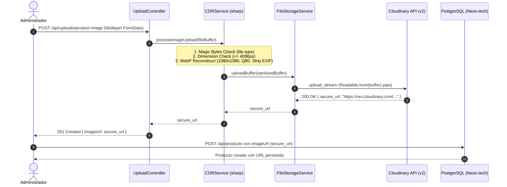

# Plan de Arquitectura e Implementación — Fase 11: Despliegue en Producción (Cloudinary, Neon.tech & Railway)

**Fase:** 011-despliegue-cloudinary-railway  
**Versión:** 1.0 (AppSec & Production Architecture)  
**Fecha:** 2026-11-06  
**Basado en:** [specs/011-despliegue-cloudinary-railway/spec.md](file:///f:/INGENIERIA\GEPI\InyectoresDiesel\specs\011-despliegue-cloudinary-railway\spec.md)  
**Estado:** Plan de Arquitectura Aprobado para Ejecución  

---

## 1. Arquitectura de Módulos y Cambios

### 1.1 Backend (`/server`)

| Archivo | Tipo | Responsabilidad / Modificación |
| :--- | :--- | :--- |
| `server/package.json` | Modificación | Instalar `cloudinary` (^2.x.x). Actualizar `"build": "prisma generate && tsc"` y `"start": "prisma migrate deploy && node dist/index.js"`. |
| `server/src/config/env.ts` | Modificación | Añadir `CLOUDINARY_CLOUD_NAME`, `CLOUDINARY_API_KEY`, `CLOUDINARY_API_SECRET` al esquema Zod `.strict()` y lista de claves requeridas. |
| `.env.example` / `server/.env` | Modificación | Documentar e inicializar variables de Cloudinary para desarrollo y despliegue. |
| `server/src/services/file-storage.service.ts` | Modificación | Configurar SDK Cloudinary v2. Implementar `uploadStreamToCloudinary(buffer, folder)` y `extractCloudinaryPublicId(url)`. Refactorizar `deleteFile` para manejar tanto Cloudinary (`destroy`) como rutas locales legacy. |
| `server/src/services/cdr.service.ts` | Modificación | Conectar la salida del buffer WebP sanitizado con `uploadStreamToCloudinary` y retornar la `secure_url`. |
| `server/src/controllers/upload.controller.ts` | Modificación | Recibir `imageUrl` (URL absoluta HTTPS) de la tubería y responderla en el JSON `{ imageUrl }`. |
| `server/src/services/product.service.ts` | Verificación / Ajuste | Garantizar que el manejo de `previousImageUrl` y borrado de productos invoque `deleteFile` sin fallas operativas ante URLs de Cloudinary. |
| `server/src/index.ts` | Modificación | Configurar `app.listen(PORT, "0.0.0.0", ...)` para vinculación explícita requerida por Railway. |

---

## 2. Flujo de Ingesta y Eliminación de Imágenes

---

## 3. Estrategia de Purga Resiliente de Imágenes (Polimórfica)

Cuando un producto se actualiza con una nueva imagen o se elimina:
1. Si `imageUrl` es de Cloudinary (`res.cloudinary.com`):
   - Se extrae el `public_id` (incluyendo la carpeta `products/`, sin la extensión `.webp` ni el prefijo de versión `v1234567890/`).
   - Se ejecuta `cloudinary.uploader.destroy(publicId)`.
2. Si `imageUrl` es una ruta local (`/uploads/<uuid>.webp`):
   - Se sanitiza con `path.basename` y se invoca `fs.unlink`.
3. Si `imageUrl` es un placeholder o no cumple las extensiones:
   - Se descarta silenciosamente.
4. Cualquier excepción se captura con `console.warn` para garantizar que la operación principal nunca falle (*Defensive Fault Isolation*).

---

## 4. Justificación de Decisiones Arquitectónicas y Trade-Offs

1. **Uso de Streams en Memoria vs Archivos Temporales en Disco:**
   - *Decisión:* Conectar el `Buffer` sanitizado directamente con `cloudinary.uploader.upload_stream` mediante `Readable.from(buffer)`.
   - *Trade-off:* Requiere algo más de memoria RAM durante la transferencia que escribir en disco, pero en un entorno efímero como Railway o contenedores de Docker sin volumen montado, evita escribir en `/tmp`, simplifica el ciclo de vida del contenedor y elimina el riesgo de fuga de descriptores de archivos o basura en disco.
2. **Crash Early en Variables de Cloudinary:**
   - *Decisión:* Marcar las 3 variables de Cloudinary como obligatorias (`.min(1)`) en el arranque.
   - *Trade-off:* Si falta alguna credencial en Railway, el contenedor no levantará (Crash Early). Esto es intencional: evita que el sistema entre en un estado de fallo silencioso donde los administradores no puedan crear productos ni subir imágenes.
3. **Escucha en `0.0.0.0`:**
   - *Decisión:* Vincular explícitamente el servidor HTTP de Express a `0.0.0.0`.
   - *Trade-off:* En entornos de hosting como Railway o Docker, escuchar únicamente en `localhost` (`127.0.0.1`) provoca que el proxy perimetral de Railway reporte `Bad Gateway` o `Service Unavailable` porque no puede rutear las peticiones externas al contenedor.

