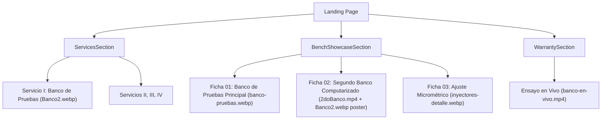

# Plan de Arquitectura e Implementación — Fase 12: Auditoría y Optimización Responsive Mobile-First & Nueva Multimedia

**Fase:** 012-landing-responsive-multimedia  
**Versión:** 1.0  
**Fecha:** 2026-11-06  
**Basado en:** [specs/012-landing-responsive-multimedia/spec.md](file:///f:/INGENIERIA\GEPI\InyectoresDiesel\specs\012-landing-responsive-multimedia\spec.md)  
**Estado:** Plan de Arquitectura Aprobado para Ejecución  

---

## 1. Módulos y Archivos a Modificar

| Archivo | Tipo | Cambios Principales |
| :--- | :--- | :--- |
| `src/assets/workshop/` | Activos | Importación de `2doBanco.mp4` y `Banco2.webp`. |
| `src/config/site-config.ts` | Modificación | Registrar `Banco2.webp` en `workshopImages` y actualizar imagen de servicio de banco si corresponde. |
| `src/components/landing/BenchShowcaseSection.tsx` | Modificación | Integrar ficha del Segundo Banco Computarizado con video `<video autoPlay muted loop playsInline poster={banco2Img}>` y fallback. Reemplazar `h-[400px]` por `aspect-video sm:aspect-[4/3] md:h-[550px]`. Ajustar tipografías de métricas a `text-3xl sm:text-4xl md:text-5xl` y reducir `space-y-32` en móvil. |
| `src/components/landing/ServicesSection.tsx` | Modificación | Configurar `grid-cols-1 md:grid-cols-2 lg:grid-cols-12` explícito en el contenedor. Flexibilizar cabecera de tarjeta (números romanos y badges) para no desbordar en 320px. Ajustar alturas de imágenes a `h-48 sm:h-56 md:h-64`. Escalar títulos con `text-2xl sm:text-3xl md:text-5xl`. |
| `src/components/landing/WarrantySection.tsx` | Modificación | Padding móvil `py-16 sm:py-24 md:py-32`. Botón WhatsApp en ancho completo en móvil (`w-full sm:w-auto`). |
| `src/components/landing/LocationSection.tsx` | Modificación | Padding de tarjeta de datos a `p-5 sm:p-8`. Altura de mapa responsiva a `h-[300px] sm:h-[380px] md:min-h-[420px]`. |
| `src/components/landing/LandingFooter.tsx` | Modificación | Padding inferior con compensación de barra sticky (`pb-24 lg:py-32`). |
| `src/components/landing/HeroSection.tsx` | Modificación | Título con escala responsiva `text-4xl xs:text-5xl sm:text-7xl md:text-8xl lg:text-[7rem]` para evitar overflow de "LABORATORIO" en 320px. Botones `w-full sm:w-auto`. |
| `src/routes/index.tsx` | Modificación | Blindaje con `overflow-x-hidden w-full` en el wrapper raíz y `<main>`. |

---

## 2. Jerarquía de Integración de Multimedia

---

## 3. Matriz de Breakpoints y Escalado Tipográfico

| Componente | Elemento | Desktop (`>= 1024px`) | Tablet (`768px - 1023px`) | Móvil Estándar (`375px - 767px`) | Móvil Estrecho (`320px - 374px`) |
| :--- | :--- | :--- | :--- | :--- | :--- |
| **HeroSection** | H1 Nombre | `text-[7rem]` | `text-8xl` | `text-6xl` | `text-4xl` |
| **HeroSection** | Botones | `w-auto inline-flex` | `w-auto inline-flex` | `w-auto inline-flex` | `w-full justify-center` |
| **ServicesSection** | H2 Título | `text-7xl` | `text-5xl` | `text-4xl` | `text-2xl` |
| **ServicesSection** | Tarjetas | `12-col bento` | `2-col grid` | `1-col apilado` | `1-col apilado (p-5)` |
| **BenchShowcase** | Media Container | `h-[550px]` | `h-[450px]` | `aspect-video` | `aspect-video` |
| **BenchShowcase** | Métricas Valor | `text-5xl` | `text-5xl` | `text-4xl` | `text-3xl` |
| **LocationSection** | Mapa Iframe | `min-h-[420px]` | `min-h-[420px]` | `h-[380px]` | `h-[300px]` |

---

## 4. Justificación de Decisiones Arquitectónicas y Trade-Offs

1. **Uso de `aspect-video` vs `h-[400px]` en imágenes y videos de taller:**
   - *Decisión:* Usar `aspect-video w-full` en resoluciones móviles.
   - *Trade-off:* En desktop una altura fija como `550px` otorga presencia imponente al banco. Sin embargo, en un móvil de 360px de ancho, una altura de 400px fuerza una orientación vertical (0.9:1) que recorta los costados del banco de pruebas donde se aprecian las tobetas, mangueras de retorno y computadoras. Con `aspect-video` en móvil, toda la maquinaria queda visible sin recorte ni barras negras.
2. **Atributo `playsInline` mandatorio en videos:**
   - *Decisión:* Inyectar `playsInline`, `autoPlay`, `muted`, `loop` y `preload="metadata"`.
   - *Trade-off:* Sin `playsInline`, iOS Safari intercepta el video al hacer scroll e intenta abrir el reproductor a pantalla completa nativo de QuickTime, arruinando la experiencia web. `playsInline` mantiene la reproducción confinada al contenedor visual de la página.
3. **Contención Global de Desborde con `overflow-x-hidden` en `index.tsx`:**
   - *Decisión:* Proteger el elemento `<main>` y el contenedor exterior con `overflow-x-hidden w-full`.
   - *Trade-off:* Evita el típico "efecto rebote" lateral en navegadores móviles que ocurre cuando una animación o texto excede el viewport por unos pocos píxeles.

